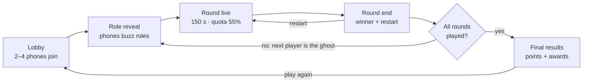
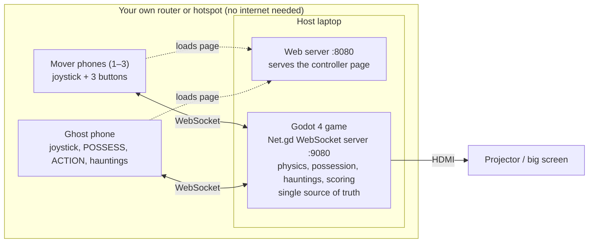

# Ghosted Movers — Game Design & Build Spec

Artificial Arcade (Atharva University) · PS02: Chaos Control · Last updated: Oct 23, 2026

## Overview

Ghosted Movers is a 2–4 player physics party game for PS02. A cheap moving company clears out haunted houses, and one player is the ghost who wants everything smashed. It's built in Godot 4, shown on one shared projector screen, and every player uses their phone as the controller.

**A round in one paragraph.** The movers have 150 seconds to carry wobbly, fragile loot out to the truck. Every bump knocks money off an item's value, and heavy items need two people. The ghost possesses furniture to block and smash things, and triggers house-wide hauntings that each have a warning and a counter. The movers win the round if the truck's value meets the quota; otherwise the ghost wins. The ghost role rotates every round.

**The feel we are aiming for:** Moving Out's chaotic co-op carrying, plus Luigi's Mansion's haunted props, plus R.E.P.O.'s fragile-loot panic. It's comedy, not horror: the screams are laughs.

**Locked decisions**

| Decision | Choice |
| --- | --- |
| Engine | Godot 4.7.2 stable (`4.7.2.stable.official.ed1daf0bf`), 3D with Jolt physics |
| Renderer | Mobile |
| Development | Cross-platform; developers on different operating systems |
| Screen | One shared screen; angled "dollhouse" camera that auto-frames all movers |
| Controllers | Phones over local Wi-Fi; keyboard and gamepad fallback |
| Players | 2–4: one ghost, the rest movers |
| Arenas | Old Mansion, Ghost Ship, Abandoned Museum |
| Tone | Bright, comedic, low-poly |

## PS02 compliance and beyond

Every compulsory requirement is met by the core game. The extra features are where the score is won.

| PS02 requirement | How Ghosted Movers meets it |
| --- | --- |
| Objective Runner and Saboteur roles | Movers carry loot to the truck; the Ghost smashes and blocks |
| Minimum 2 active players | 2–4 players; a 1v1 (one mover against the ghost) is fully playable |
| Minimum 3 arenas | Old Mansion, Ghost Ship, Abandoned Museum |
| At least 3 interactive environmental elements | Possessable props, plus House Shake, Gust of Wind and Lights Out hauntings |
| Role switching after each round | The Ghost passes to the next player every round |
| Limited sabotage | Ghost energy bar, haunting cooldowns, exorcism by flashlight |
| Timer or points scoring | 150 s round timer; a value quota; individual points |
| Win/loss, restart, final results | Quota met or not; a restart-round button; a final leaderboard with awards |

**Beyond the brief**

- **Phones as controllers.** Judges join in seconds by scanning a QR code.
- **Physics comedy.** Two-person carries, items losing value on every bump, movers tumbling.
- **Fair hauntings.** Each one has a warning and a counter-move, so skill beats luck.
- **Awards on the results screen**, such as Butterfingers and Piano Killer, so every player gets a moment.
- **Stretch: audience mode.** Spectators vote on the ghost's next global haunting.

## Match flow

A match is a set of rounds where the ghost role passes along each time. Each state is its own Godot scene; `Game.gd` broadcasts the current state so every phone switches to the right screen.



**Round rules**

- **Start.** A 3-second countdown: movers spawn at the truck, the ghost wisp spawns at the far end of the house.
- **Live.** The timer and the truck-value bar show on screen. In the last 30 s the music speeds up and the quota line pulses.
- **End.** The round ends when the timer hits zero, or early once the quota is met and nothing is being carried. The screen shows who won and each player's points.
- **Restart.** Replays the same arena with the same roles; points from the aborted attempt are discarded.

## Movers

Movers have one job: get value onto the truck. Every control is about carrying well under pressure. All numbers are starting values in `Balance.gd`.

**Controls (phone)**

| Input | Action |
| --- | --- |
| Joystick | Move. Base speed 4.5 m/s, reduced by what you carry. |
| GRAB (hold) | Pick up the nearest item in front of you. Let go to drop it. |
| THROW (tap while holding) | Throw a light item. Fast, but it lands hard and takes damage. Medium and heavy loot cannot be thrown. |
| BRACE (hold) | Plant your feet. You can't move, but shake and wind can't knock you over. |

**Carrying**

- The held item is pulled toward a hold point in front of the mover by a spring force, not locked rigidly. It wobbles, swings and clips doorframes, which is where the comedy comes from.
- Carried items hang low, a fixed gap above the floor, so letting go never damages them. Throws and bumps still do.
- Speed while carrying: light 100%, medium 80%, heavy 60%.
- **Two-person items** (piano, wardrobe, sofa) have two grab handles. With both handles held, they move at 70% speed, steered by the average of both joysticks. With one handle, the item can only be dragged at 25%, and dragging scrapes value off.
  - Each holder pulls their own handle toward their joystick, so pulling the same way moves the item and pulling differently turns it. Holders stay attached to their handles and let go if pulled too far off their spot.
  - Dragging scrapes 1.5% of the item's current value per metre dragged.
- In a 2-player match, the lone mover can drag two-person items at 40% (it still scrapes). Until match flow exists, this applies whenever only one mover is active; the ghost's slot does not count.

**Damage**

- Every item has a value, a weight and a fragility (1–3).
- Any collision above 2.5 m/s costs `impact speed × fragility × 4%` of its current value.
- Impact speed is relative closing speed along the collision normal. Count each distinct impact once, rather than each physics frame of resting contact. Round damage up to whole rupees and cap it at the item's remaining value.
- A floating red price drop pops off the item ("−₹1,200") and the price tag above it ticks down.
- At zero value the item shatters, disappears, and counts toward the ghost.

**Banking.** Release an item inside the truck zone and it banks: the value locks, a cash-register sound plays, and it despawns with a floating "+₹4,500".

- Only releasing GRAB inside the zone banks. Loot that is thrown, pushed or slid in by the ghost stays in play until a mover picks it up and releases it there.
- A two-person item banks when its last holder lets go inside the zone. If one holder lets go first, the other is left dragging it.

**The flashlight**

- One flashlight lies in each arena; with 4 players, two. It's an item, so carrying it means not carrying loot. It is light and can be thrown; it has no value, takes no damage and does not bank.
- Hold its beam on a glowing possessed prop for 1.5 s to exorcise the ghost. The ghost is ejected, stunned and cannot possess anything for 5 s. Stunned means the wisp is frozen for 1 s: it cannot move or use any button, hauntings included.
- The beam reaches 8 m and walls block it. Its aim ignores height, so a raised prop such as a chandelier can be lit from below.

**Tumbling.** You fall over if:

- you move during a House Shake ("moving" means pushing the stick or sliding, for example on slime),
- you move with a Gust of Wind, or
- a possessed or thrown prop hits you above 4 m/s.
  - A prop counts as thrown from THROW until it slows below 4 m/s or comes to rest.
  - A possessed prop counts by its own speed toward you, so walking into a slow possessed prop never trips you. A prop launched by a ghost action (SHOVE, DROP) keeps counting after the ghost leaves, until it slows below 4 m/s.

You drop whatever you hold and are down for 1.5 s, then stand up automatically. This uses a simple fall animation, not ragdoll physics.

## The Ghost

The ghost wins by smashing value and wasting time, never by cheap surprise. Every action glows, creaks or rumbles first, so movers always get a chance to react.

**Moving as a wisp**

- When not possessing anything, the ghost is a faint, shimmering wisp on the shared screen. It moves at 7 m/s and passes through walls.
- It's hard to see, but not invisible: sharp movers can track it. It flies 1.2 m up, its opacity shimmers between 25% and 45%, and it stays inside the house and truck area so it never leaves the screen.
- While possessing, the wisp hides inside the prop; leaving puts it back where the prop is.

**Possession**

- Move the wisp into any prop with a possessable outline and tap POSSESS. The wisp must be within 0.6 m of the prop's footprint; the prop it would take shows a bright outline.
- The prop glows green and drips particles. The joystick now moves the prop, and the action button does that prop's special move.
- Possession drains 8 energy per second. Leaving a prop is free. When energy runs out, the ghost is pushed out.
- Every loose loot item, the piano included, can be possessed as a slider; heavier items move slower. The flashlight cannot be possessed.
- Rules that keep it fair:
  - The ghost can't possess an item someone is carrying, and a possessed item can't be grabbed until the ghost leaves or is exorcised.
  - Nothing inside the truck zone can be possessed. A possessed prop that enters the zone pushes the ghost out, with no stun.
  - After an exorcism, the ghost can't possess anything for 5 s.

| Prop type | Examples | Joystick | Action button | Action cost |
| --- | --- | --- | --- | --- |
| Slider | Sofa, crate, table | Push it around | SHOVE: a strong burst in one direction | 15 |
| Door | Room doors, cabin hatches | — | SLAM: shuts and holds it locked for 3 s | 20 |
| Dropper | Chandelier, ship lantern, hanging exhibit | — | DROP: creaks for 1 s, then falls. One use each. | 30 |
| Hopper | Fridge, suit of armour, statue | Hop toward a direction | STOMP: a shockwave that tumbles anyone within 2 m | 25 |
| Rug | Rugs, deck tarps | — | YANK: everything on it slides and movers tumble | 25 |

How each prop type moves (starting values in `Balance.gd`):

- **Slider.** The prop glides at 2.4 m/s, just under the 2.5 m/s damage threshold, so plain sliding never breaks anything; only SHOVE does. SHOVE launches it at 6 m/s along the stick, or the last direction it moved. Both speeds scale by weight class: light × 1.0, medium × 0.8, heavy × 0.6, two-person × 0.45.
- **Door.** It rests open at 100° and SLAM shuts it in 0.3 s. Movers in its swing tumble. If loot is in the way, the door stops there and the item takes one hit at the door's speed where it stands. After the 3 s lock it reopens over 1 s.
- **Dropper.** DROP is committed once triggered: the chandelier creaks for 1 s while a floor marker shows where it will land, then falls even if the ghost is exorcised meanwhile. It hangs with its bottom 2.8 m up, so it lands on a head faster than 4 m/s. Afterwards it lies on the floor as debris and can't be possessed again; the ghost pops out without a stun.
- **Hopper.** While the stick is held it hops every 0.55 s, 2.5 m/s along the stick and 3.5 m/s up. STOMP tumbles every mover within 2 m, braced or not.
- **Rug.** YANK pulls the rug along its own forward axis: movers standing on it tumble, and anything loose on it slides away at 3.5 m/s.

**Global hauntings**

Each arena has its signature haunting, and Ecto Slime is available everywhere. Each haunting has a warning first and a clear counter.

| Haunting | Arena | Warning (before it hits) | Effect | Counter | Energy | Cooldown |
| --- | --- | --- | --- | --- | --- | --- |
| House Shake | Old Mansion | Rumble, ceiling dust, small camera shake for 1 s | 2.5 s: anyone moving tumbles; shelf items fall | Stand still or BRACE | 45 | 20 s |
| Gust of Wind | Ghost Ship | Wind streaks and a whistle show the direction for 1 s | 3 s: moving with the wind tumbles you; standing still slowly pushes you | BRACE, or walk against or across the wind | 40 | 18 s |
| Lights Out | Abandoned Museum | Lights flicker for 1 s | 6 s of darkness except the flashlight cone and the truck light | Stick near the flashlight carrier | 50 | 25 s |
| Ecto Slime | All arenas | The wisp leaves a green trail | For 4 s, movers on slime slide with their momentum | Walk around it | 25 | 10 s |

- **House Shake.** "Moving" means the stick is pushed or the mover is sliding; BRACE protects. Shelf items falling waits for the Phase 6 Mansion, since the greybox has no shelves.
- **Ecto Slime.** For 4 s after casting, the wisp drops slime patches 0.8 m wide, one every 0.6 m of its path. Each patch lasts 4 s. Movers on slime keep their momentum and steer poorly.

**Energy.** The ghost has 100 energy. It regenerates 12 per second while the ghost is a free wisp, and 0 while possessing. Energy is the main balance knob.

## Arenas

Three single-floor, roofless houses, each with its own layout, signature haunting and hazard. Each holds 9–12 items worth ₹60,000–70,000 in total. Each sits on one ground plane (ramps allowed, no stairs) so the shared camera always works.

| Arena | Layout | Signature haunting | Arena-only hazard | Light and colour |
| --- | --- | --- | --- | --- |
| Old Mansion | Six rooms off a central hall; truck at the front door; piano in the far parlour | House Shake | Many doors and two chandeliers over the main route | Warm lamplight, purple wallpaper |
| Ghost Ship | Open deck, crate stacks, a narrow gangplank with no rails down to the truck on the dock | Gust of Wind | Water: anything that falls overboard is lost | Moonlight blue, green lanterns |
| Abandoned Museum | Long galleries of pedestals; the furthest distance to the truck | Lights Out | Very fragile, very valuable exhibits | Cold white spotlights, dusty fog |

**Loot list** (fragility: 1 = sturdy, 3 = glass)

| Arena | Item | Count | Value each (₹) | Weight | Fragility |
| --- | --- | --- | --- | --- | --- |
| Old Mansion | Grand piano | 1 | 20,000 | Two-person | 2 |
| Old Mansion | Grandfather clock | 1 | 8,000 | Heavy | 2 |
| Old Mansion | Oil painting | 2 | 6,000 | Light | 1 |
| Old Mansion | Old TV | 2 | 5,000 | Medium | 3 |
| Old Mansion | Antique vase | 4 | 3,000 | Light | 3 |
| Old Mansion | Armchair | 2 | 2,000 | Medium | 1 |
| Ghost Ship | Treasure chest | 1 | 18,000 | Two-person | 1 |
| Ghost Ship | Ship-in-a-bottle | 3 | 5,000 | Light | 3 |
| Ghost Ship | Brass telescope | 2 | 4,000 | Light | 2 |
| Ghost Ship | Captain's portrait | 1 | 7,000 | Medium | 1 |
| Ghost Ship | Rum barrel (rolls if dropped) | 4 | 3,000 | Medium | 1 |
| Abandoned Museum | Dinosaur skull | 1 | 25,000 | Two-person | 2 |
| Abandoned Museum | Crystal sculpture | 2 | 9,000 | Medium | 3 |
| Abandoned Museum | Ming vase | 2 | 6,000 | Light | 3 |
| Abandoned Museum | Golden mask | 2 | 4,000 | Light | 1 |
| Abandoned Museum | Marble bust | 2 | 3,000 | Medium | 2 |

Every arena has exactly one two-person centrepiece worth about a third of the house. It's the round's big gamble: going for it wins the quota, and dropping it hands the round to the ghost.

## Scoring and balance

Each round has a clear team result: the movers either hit the quota or they don't. Individual points then decide the overall winner across the match.

**Round result**

- Movers win if banked value reaches **55% of the house's total value** before the 150 s timer runs out.
- The round ends early if the quota is met and nothing more is being carried, or if nothing bankable is left.
- If the quota is missed, the ghost wins the round.

**Individual points**

| Role | How you score |
| --- | --- |
| Mover | 1 point per ₹100 you bank; two-person items split evenly. +100 each if the quota is met. |
| Ghost | 1 point per ₹100 destroyed (damage, shattering, overboard). +150 if the quota fails. |

**Rounds per match.** Every player is the ghost the same number of times, so totals stay fair: 2 players play 4 rounds, 3 players play 3, and 4 players play 4. Arenas cycle Mansion → Ship → Museum.

**Restart.** A restart button on the round-end screen (or the R key on the host laptop) replays the same arena with the same roles.

**Awards on the final screen**

- **Mover of the Year:** most value banked.
- **Butterfingers:** most value lost while carrying.
- **Piano Killer:** destroyed a centrepiece.
- **Poltergeist Pro:** most value destroyed as the ghost.
- **Exorcist:** most exorcisms.
- **Tumbleweed:** most tumbles.

**Tune these first.** All live in `Balance.gd`. Change one at a time between playtests.

| Knob | Start value | If movers win too easily | If the ghost wins too easily |
| --- | --- | --- | --- |
| Ghost energy regen | 12 /s | Raise to 15 | Lower to 9 |
| Quota | 55% | Raise to 65% | Lower to 45% |
| Round time | 150 s | Lower to 120 s | Raise to 180 s |
| Damage multiplier | 4% per m/s × fragility | Raise to 5% | Lower to 3% |
| Possession drain | 8 /s | Lower to 6 | Raise to 10 |

## Camera, visuals and audio

The game is judged on a projector from across a room. Everything must read instantly: big shapes, strong colours, loud feedback.

**Dollhouse camera**

- A `Camera3D` angled about 55° down, looking into roofless rooms.
- It follows the centre point of all movers. Its distance scales with how spread out they are (12 m to 26 m) and eases smoothly, so it never snaps.
- It is clamped to the arena bounds, so it never shows the void.
- **Shake** uses a trauma value (shake = trauma² × noise), raised by tumbles, drops, shattering and hauntings.
- **Punch-in** when an item worth ₹10,000+ shatters: a 0.3 s zoom plus 0.4 s at half speed (`Engine.time_scale`). This is the clip people will remember.

**Walls never hide players**

- Walls on the camera side are knee-high, the Moving Out trick.
- For any other wall, cast a ray from the camera to each mover. A wall it hits fades to 30% opacity through a shader parameter.

**Art direction**

- One consistent low-poly style from CC0 packs: Kenney Furniture Kit and KayKit for props, Quaternius for characters. Don't mix styles.
- Movers: chunky characters in team colours, with a name tag overhead.
- Every item shows a price tag above it that ticks down and turns red as value drops.
- Ghost: a translucent bedsheet wisp with trailing particles. Possessed props get a green glow, an outline shader and dripping ectoplasm.
- `WorldEnvironment`: glow (bloom), filmic tonemapping, depth fog in the museum. The Mobile renderer has no SSAO or volumetric fog, so fake contact shadows with darker texture bases or blob shadows under items.

**On-screen HUD**

- Top centre: round timer, and a truck-value bar filling toward a marked quota line.
- Top right: the ghost's energy bar, visible to everyone (it's a tell).
- Above each mover: a small icon for what they're holding.

**Audio**

| Event | Sound |
| --- | --- |
| Item banked | Cash register "ka-ching", pitched up for big items |
| Damage | Thud for sturdy items, glass crack for fragile ones; louder the more value lost |
| Shatter | A big crash plus a sad trombone above ₹10,000 |
| Possession | A creak and a theremin swell |
| Haunting warning | Each has its own sting: rumble, wind whistle, flickering buzz |
| Tumble | A cartoon "boing" |
| Music | A spooky-comedy loop that speeds up in the last 30 s |

Sources: Kenney audio packs, CC0 sounds from freesound.org, and jsfxr for quick UI bleeps.

## Phone controllers

One web page with three screens (lobby, Mover, Ghost). The host decides which screen each phone shows. Phones are held in landscape, with the thumbs on the joystick and buttons, and eyes on the projector, so buttons are big and few.

**Mover screen**

```
┌────────────────────────────────────────────┐
│ ● RIYA        holding: Antique vase ₹2,640 │
│                                            │
│     ( joystick )           [  GRAB  ]      │
│   appears where your                       │
│   thumb lands         [THROW]  [BRACE]     │
└────────────────────────────────────────────┘
```

**Ghost screen** (green-tinted, so the role is obvious at a glance)

```
┌────────────────────────────────────────────┐
│ GHOST   energy ▓▓▓▓▓▓▓▓░░░░  64            │
│                         [POSSESS / LEAVE]  │
│     ( joystick )        [ ACTION: SLAM ]   │
│                     [SHAKE 45]  [SLIME 25] │
│                      cooldown ring on each │
└────────────────────────────────────────────┘
```

- The ACTION label changes with the prop type: SHOVE, SLAM, DROP, STOMP, YANK. POSSESS reads LEAVE while the ghost is inside a prop.
- Haunting buttons grey out when energy is too low or they're cooling down. The host still validates every action.
- The host decides what greys out (the `hud` message's `ok` flags), so the phone never duplicates a rule. Greyed buttons still send presses, and the host ignores them.

**Between rounds**

- The lobby screen shows name entry, your colour and a Ready button.
- The role reveal is a full-screen "YOU ARE THE GHOST" or "YOU'RE A MOVER" with a buzz.
- The round result shows win or lose and your points this round.

**Technical requirements**

- Pointer events with multi-touch, so the joystick and a button work at the same time. Use nipplejs in dynamic mode for the joystick.
- `touch-action: none` and no pinch-zoom. The page never scrolls.
- Fullscreen on first tap. Lock to landscape where supported (Android Chrome). On iOS, show a "rotate your phone" overlay instead.
- Request the Wake Lock API when available. Plain LAN HTTP is not a secure context, so otherwise show guidance to increase the phone's screen timeout for the demo.
- `navigator.vibrate` on damage and tumbles. This works on Android only and is a bonus.

## Technical architecture

Everything runs on one laptop. A tiny web server hands each phone the controller page once. After that, phones talk directly to the Godot game over WebSocket.



**How the bridge works in Godot.** `Net.gd` opens a `TCPServer` on port 9080. Each incoming connection is upgraded with `WebSocketPeer.accept_stream()`, and every peer is polled in `_process`. Messages are JSON text. No Godot multiplayer API is needed, because phones are plain browsers, not Godot clients.

**Serving the page.** Run `python -m http.server 8080` inside `controller/` (`python3` or `py` depending on how Python is installed). Phones open `http://<laptop-ip>:8080`, and the page connects to `ws://<laptop-ip>:9080`. Use plain `http`: an `https` page is not allowed to open a `ws://` connection.

**Stretch goal.** A ~40-line static file server inside Godot, also on `TCPServer`, would make the game one self-contained executable.

**Physics settings.** Jolt physics engine, 60 Hz physics tick, continuous collision detection on small fragile items, and a cap on the carry spring force.

## Network protocol

Phones talk directly to the Godot game over WebSocket, sending short JSON messages. Godot is the single source of truth: phones send intent and receive only what their own screen needs.

**Wire format.** Each JSON object has a `type` discriminator alongside its payload fields, for example `{"type":"in","x":0.5,"y":-0.5}`. Slots are zero-based (0–3); player-facing labels are 1–4. Positive joystick x means right; positive y means toward the bottom of the screen. The input vector is limited to length 1 by the host.

| Message | Direction | Payload | When |
| --- | --- | --- | --- |
| `hello` | phone → host | `{name, pid?}` | Page opens; `pid` is sent when rejoining |
| `welcome` | host → phone | `{pid, slot, colour}` | Join accepted |
| `lobby` | host → all | `{players:[{name, colour, ready}]}` | Anyone joins, leaves or readies up |
| `ready` | phone → host | `{}` | Ready button |
| `role` | host → phone | `{role: "mover" or "ghost", arena}` | Round start |
| `in` | phone → host | `{x, y}` joystick, −1 to 1 | 30 per second while the screen is active; also acts as the heartbeat |
| `btn` | phone → host | `{b, down}`; b = grab, throw, brace, possess, action, haunt1, haunt2 | On press and on release |
| `hud` | host → phone | Mover: `{held, value}`; Ghost: `{energy, action, costs, cd, ok}`; both: `{t}` | 8 per second |
| `buzz` | host → phone | `{ms}` | Damage, tumble, role reveal |
| `result` | host → all | `{moversWon, points}` | Round end |
| `final` | host → all | `{standings, awards}` | Match end |

**The ghost's `hud` fields**

- `energy`: whole energy points.
- `action`: the possessed prop's ACTION label, or empty while the ghost is a free wisp.
- `costs`: `{action, haunt1, haunt2}` energy costs, for the button labels.
- `cd`: `{possess, haunt1, haunt2}`, the fraction of each cooldown still left (0–1), for the rings. `possess` is the 5 s lock after an exorcism.
- `ok`: `{possess, action, haunt1, haunt2}`, whether the host would accept that button right now.

**Rules that prevent bugs**

- **The joystick is state, not events.** The host keeps the latest vector per player and reads it every physics frame.
- **Buttons send both edges.** GRAB is held from `down` until `up`.
- **Dead-man switch.** If no `in` arrives from a phone for 500 ms, the host zeroes its joystick and releases its buttons. A dropped connection never leaves someone stuck carrying or walking.
- **Reconnect.** The phone stores `pid` in localStorage. Rejoining with it restores the slot, role and points.
- Slots remain reserved for the host session so disconnected phones can rejoin. An unknown `pid` is treated as a new join if space remains; a fifth identity is declined. Restart the host to clear the Phase 1 test roster.
- The host validates every ghost action against energy and cooldowns, and ignores unknown messages.

## Godot project structure

Everything is a small, self-contained scene, so people rarely need to open the same file. Behaviour is attached as components (child nodes with a script): adding a `Possessable` node to any prop makes it hauntable.

```
ghosted-movers/
├── project.godot
├── autoload/
│   ├── Net.gd            # TCPServer + WebSocketPeer per phone, JSON in/out, player registry
│   ├── Game.gd           # match state machine, rounds, roles, scores, awards
│   ├── Balance.gd        # every tunable number, nothing else
│   └── Sfx.gd            # one-line sound calls: Sfx.play("bank", pitch)
├── core/
│   └── InputRouter.gd    # phone / keyboard / gamepad → one PlayerInput per slot
├── screens/
│   ├── Lobby.tscn        # QR code, joined players
│   ├── RoleReveal.tscn
│   ├── RoundEnd.tscn
│   ├── Results.tscn      # leaderboard + awards
│   └── HUD.tscn
├── actors/
│   ├── Mover.tscn        # CharacterBody3D, hold point, carry spring, tumble
│   ├── GhostWisp.tscn    # wisp, energy, possession and the host's checks on every ghost button
│   └── PartyCamera.tscn  # framing, shake, punch-in, wall fade (Phase 4: fixed view and shake only)
├── props/
│   ├── carryable.gd      # shared spring carry, throws and impacts for loot and the flashlight
│   ├── Loot.tscn         # base RigidBody3D: value, weight, fragility, handles, price tag
│   ├── loot/             # inherited scenes: Piano.tscn, Vase.tscn, Chest.tscn …
│   ├── Possessable.gd    # component: kind = slider | door | dropper | hopper | rug
│   ├── furniture/        # valueless possessable props: Crate, Door, Chandelier, Armour, Rug
│   ├── Flashlight.tscn
│   └── TruckZone.tscn
├── hauntings/
│   ├── Haunting.gd       # base: warn() → run() → end(), cost, cooldown
│   ├── HouseShake.gd
│   ├── GustOfWind.gd
│   ├── LightsOut.gd
│   └── EctoSlime.gd
├── arenas/
│   ├── ArenaBase.gd      # spawn points, camera bounds, signature haunting, total value
│   ├── Mansion.tscn
│   ├── Ship.tscn
│   └── Museum.tscn
├── assets/               # models/, audio/, fonts/
└── controller/           # the phone web page; contains a .gdignore so Godot skips it
    ├── index.html
    ├── controller.js
    ├── style.css
    └── nipplejs.min.js
```

**Scene ownership.** Each area has exactly one owner, who is the only person to edit those files. Assign names at hour 0.

| Area | Files | Owner |
| --- | --- | --- |
| Core and match flow | `autoload/`, `Main.tscn`, `screens/` | One person (the integrator) |
| Movers and camera | `actors/Mover.tscn`, `actors/PartyCamera.tscn` | One person |
| Props, loot and ghost | `props/`, `actors/GhostWisp.tscn`, `hauntings/` | One person |
| Each arena | `arenas/<Arena>.tscn` | One person per arena; levels only *instance* props, never edit them |
| Phone page | `controller/` | One person (plain web code, no conflicts with Godot) |

**Git rules for Godot 4**

- Add `.godot/` to `.gitignore`.
- Commit the `.uid` files Godot creates next to scripts. Missing ones break references for everyone else.
- Commit small and often. Pull before opening any scene you don't own.
- To change something you don't own, ask its owner, or make an inherited scene in your own folder.

**Implementation style.** Use typed GDScript with tabs, snake_case members/functions, PascalCase classes and UPPER_SNAKE_CASE constants. Keep header/section comments short. Preserve filenames named in this spec; new supporting scripts use snake_case. All tunable numbers live in `autoload/Balance.gd`. `core/export_controller_settings.gd` generates the controller's `settings.json` from those values; regenerate it after changing browser settings.

**Phase 1 harness.** `Main.tscn` with `main.gd` instances four minimal `actors/Mover.tscn` capsules, using `actors/mover.gd`. `Balance`, `Net` and `InputRouter` are autoloads. `InputRouter` exposes one `PlayerInput` snapshot per slot, with direction, held buttons and both edge sets. Connected phones take priority; keys 1–4 select an unconnected keyboard slot, WASD/arrows move, Space grabs, E throws and Shift braces. Ready phones receive mover controls in this test only; real role rotation remains Phase 5. Grab/throw are displayed as input only until Phase 2. `core/plumbing_check.gd` verifies real socket traffic and capsule movement. See `README.md` for run and check commands. No match-flow or sound stubs are required in Phase 1.

**Phase 2 harness.** `Main.tscn` instances a one-room CSG greybox (`arenas/Mansion.tscn`) with vase, TV and clock loot and a `TruckZone`, plus four movers. `Sfx.gd` holds a procedural banking sound until real audio arrives in Phase 7. `core/carrying_check.gd` verifies carrying, damage, banking and grab conflicts with real Jolt physics.

**Phase 3 greybox.** The grand piano (2.2 × 1.0 × 1.4 m, 100 kg) starts in a back parlour behind a partition with a 2.0 m doorway, so it must be turned to fit through. The partition is knee-high (0.7 m), like other camera-side walls, so the camera sees into the parlour; it still blocks movers and a carried piano. One flashlight lies in the main room. The flashlight's beam timer works against anything in the `possessables` group exposing `is_possessed()` and `exorcise()`; Phase 4's `Possessable` provides them. `core/team_carry_check.gd` verifies two-person carry, tumbling and the flashlight.

**Phase 4 greybox.** Until Phase 5's role rotation, the host key G passes the ghost to the next active slot (a connected phone, or the keyboard's slot), and after the last one back to no ghost. That slot's mover leaves play, its phone switches to the ghost screen, and a wisp starts at the far end of the parlour with full energy. The lone-mover rule counts movers only. Keyboard ghost keys: Q possess, F action, Z haunt 1, X haunt 2. The greybox adds one valueless prop of each type from `props/furniture/`: a crate (slider), a door in the parlour doorway (door), a chandelier over the main lane (dropper), a suit of armour by the parlour wall (hopper) and a rug inside the front door (rug). Every loot item carries a slider `Possessable`. The signature haunting is House Shake. A top-right panel shows the ghost's energy to everyone. `core/ghost_check.gd` verifies the wisp, possession rules, all five actions, energy, exorcism and both hauntings with real Jolt physics.

## 24-hour build plan

The riskiest thing, physics carrying, gets built first. A complete playable match exists by hour 14, and every PS02 requirement is met by hour 18. The last 6 hours are for fun, polish and the demo. Don't start a phase until the previous phase's check passes.

1. **H0–2 · Plumbing.** Godot project and folders, `Net.gd` WebSocket server, controller page served from the laptop, keyboard fallback in `InputRouter`.
   - Check: 4 phones each move their own capsule on screen, with no noticeable lag.
2. **H2–6 · Carrying core.** Mover controller, base `Loot` with spring carry, impact damage, price tags, truck banking, one greybox room built from CSG shapes.
   - Check: carry a vase to the truck; bumping a wall visibly drops its value.
3. **H6–9 · Two-person carry, tumbling, flashlight.** This is the hardest tuning in the project.
   - Check: two players get the piano through a doorway and laugh doing it.
   - Fallback if it isn't fun by H9: centrepieces become heavy single-person items at 40% speed.
4. **H9–12 · Ghost.** Wisp movement, the `Possessable` component with all 5 prop types, energy, exorcism, House Shake and Ecto Slime.
   - Check: a 1v1 round in greybox is tense and fair.
5. **H12–14 · Match flow.** Lobby with QR code, role reveal, ghost rotation, timer and quota, round end with restart, results with awards, HUD.
   - Check: a 4-player match runs from lobby to results with no restart. **This is the minimum viable game.**
6. **H14–18 · Arenas and look.** Build Mansion, Ship and Museum with the asset packs. Add Gust of Wind and Lights Out, finish the party camera and wall fade, set up lighting per arena.
   - Check: every PS02 requirement is met. **This is the safe submission; commit and tag it.**
7. **H18–21 · Juice and playtest.** Sounds, music, particles, the shatter punch-in, phone buzz. Play full matches with 2, 3 and 4 players and tune `Balance.gd`.
8. **H21–22.5 · Feature freeze.** Bug fixes only. Export a build for the demo laptop's OS, test on the venue network, confirm the keyboard and gamepad fallback.
9. **H22.5–24 · Demo prep.** Rehearse the pitch below, record a backup gameplay video, leave the lobby screen running as an attract loop.

**If behind, cut in this order:**

1. Lights Out haunting (three environmental elements still remain)
2. Rug and Hopper prop types
3. Fog and extra lighting polish
4. Awards (keep the leaderboard)
5. Reconnect support
6. The second flashlight

**Never cut:** 3 arenas, ghost rotation, the quota, restart, the results screen.

## Risks and venue checklist

The two risks most likely to sink the demo are the network and physics, not features. Both have fixes you can test before the event.

| Risk | Mitigation |
| --- | --- |
| Venue Wi-Fi blocks phones from reaching the laptop | Bring your own router or hotspot; no internet is needed. Reserve a fixed IP for the laptop so the QR code never changes. Print the QR code as a backup. |
| The OS firewall blocks the game's ports on first launch | Run the exported build once on the demo laptop and allow ports 8080 (page) and 9080 (WebSocket) on private networks, whatever the OS. Test from a phone before the event. |
| Physics glitches: items jittering, launching or passing through walls | Cap the carry spring force and item speed. Turn on continuous collision detection for small fragile items. Keep about 40 active physics bodies or fewer. |
| Two-person carrying isn't fun | Decide at H9: fall back to heavy single carry (see the build plan). |
| Demo laptop has weak graphics | Test the real demo laptop by H6. If it struggles, lower the 3D render scale to 0.75 with FSR 1.0 upscaling and reduce shadows. |
| Judges don't understand what to do | The role reveal shows one line per role: "Carry it to the truck. Don't break it." / "Break everything." |
| Phones sleep, rotate or zoom | Wake Lock, fullscreen, landscape lock or overlay, `touch-action: none` |
| Mismatched art styles look cheap | Choose the asset packs at H0 and use nothing else |

**Pack for the venue**

- [ ] Router or a spare phone for the hotspot, and its password written down
- [ ] Demo laptop, charger, HDMI adapter, extension cord
- [ ] 4 charged team phones as backup controllers
- [ ] Keyboard, and gamepads if you can borrow them
- [ ] Printed QR code card
- [ ] Exported build plus project source on a USB stick
- [ ] Recorded backup gameplay video

## Demo script

Let the judges play within 15 seconds. A teammate plays the first ghost so the hauntings are shown off well. Use a 60-second demo round (a `Balance.gd` preset), not the full 150 s.

1. **0:00–0:15 · Hook.** "Mumbai's cheapest moving company. One problem: every house is haunted." The lobby is already on the projector; hand judges the QR card.
2. **0:15–0:25 · Roles.** Phones buzz with the role reveal. Judges are movers; a teammate is the ghost.
3. **0:25–1:25 · One round in the Old Mansion.** Narrate the moments as they happen:
   - price tags ticking down on every bump,
   - two judges wrestling the piano through a door,
   - the House Shake warning, and the counter ("freeze!"),
   - a flashlight exorcism kicking the ghost out of a sofa.
4. **1:25–1:45 · Results.** Round result, then the awards screen. Read out Butterfingers.
5. **1:45–2:00 · How it's built.** Godot 4, phones over a local WebSocket bridge, 3 arenas, ghost rotation, and fair hauntings with a warning and a counter.

**Have answers ready for**

- "How do you keep the ghost from being overpowered?" Energy, cooldowns, exorcism, and every haunting warns first.
- "Why phones?" Anyone joins in seconds, and the ghost gets its own controls without a second screen.
- "What's next?" Audience voting on hauntings, more houses, online play.
