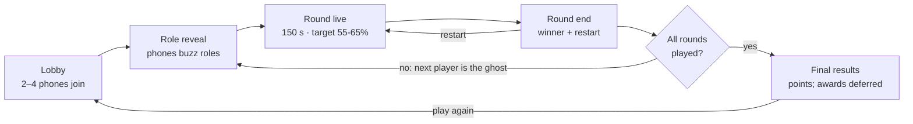

# Ghosted Movers — Game Design & Build Spec

Artificial Arcade (Atharva University) · PS02: Chaos Control · Last updated: Oct 23, 2026

## Overview

Ghosted Movers is a 2–4 player physics party game for PS02. A cheap moving company clears out haunted houses, and one player is the ghost who wants everything smashed. It's built in Godot 4, shown on one shared projector screen, and every player uses their phone as the controller.

**A round in one paragraph.** The movers have 150 seconds to carry wobbly, fragile loot out to the truck. Every bump knocks money off an item's value, and heavy items need two people. The ghost possesses furniture to block and smash things, and triggers house-wide hauntings that each have a warning and a counter. The movers win the round if the truck's value meets the quota; otherwise the ghost wins. The ghost role rotates every round.

**The feel we are aiming for:** Moving Out's chaotic co-op carrying, plus Luigi's Mansion's haunted props, plus R.E.P.O.'s fragile-loot panic. It's comedy, not horror: the screams are laughs.

**Locked decisions**

| Decision | Choice |
| --- | --- |
| Engine | Godot 4.7.2 stable (`4.7.2.stable.official.ed1daf0bf`), 3D with Jolt physics |
| Renderer | Mobile |
| Development | Cross-platform; developers on different operating systems |
| Screen | One shared screen; angled "dollhouse" camera that auto-frames all movers |
| Controllers | Phones over local Wi-Fi; keyboard and gamepad fallback |
| Players | 2–4: one ghost, the rest movers |
| Arenas | Old Mansion, Ghost Ship, Museum of Mostly Real Things |
| Tone | Bright, comedic, low-poly |

## PS02 compliance and beyond

The core design covers every compulsory requirement; the three-arena submission is still unfinished. The extra features are where the score is won.

| PS02 requirement | How Ghosted Movers meets it |
| --- | --- |
| Objective Runner and Saboteur roles | Movers carry loot to the truck; the Ghost smashes and blocks |
| Minimum 2 active players | 2–4 players; a 1v1 (one mover against the ghost) is fully playable |
| Minimum 3 arenas | Old Mansion, Ghost Ship, Museum of Mostly Real Things |
| At least 3 interactive environmental elements | Possessable props, plus House Shake, Gust of Wind and Lights Out hauntings |
| Role switching after each round | The Ghost passes to the next player every round |
| Limited sabotage | Ghost energy bar, haunting cooldowns, Battery Run: optional generator task that weakens the ghost |
| Timer or points scoring | 150 s round timer; a value quota; individual points |
| Win/loss, restart, final results | Quota met or not; a restart-round button; a final leaderboard with awards |

**Beyond the brief**

- **Phones as controllers.** Judges join in seconds by scanning a QR code.
- **Physics comedy.** Two-person carries, items losing value on every bump, movers tumbling.
- **Fair hauntings.** Each one has a warning and a counter-move, so skill beats luck.
- **Awards on the results screen**, such as Butterfingers and Piano Killer, so every player gets a moment.
- **Stretch: audience mode.** Spectators vote on the ghost's next global haunting.

## Current demo scope — approved Phase 5

The current demo uses the supplied Old Mansion layout and mover character assets; the greybox remains the regression harness. Build a complete match before art or extra abilities. The arena/ability catalog below includes later work; only possession/SHOVE, House Shake and Curse are enabled in the demo. Existing door, chandelier, hopper, rug and slime code is retained for regression tests. Awards, expanded loot, cinematic zoom and slow motion are deferred. Room progress is included in the approved UI pass.

- **Curse:** the free wisp targets nearby unbanked loot, including held loot, using the same 1.2 m aim-assisted footprint reach as POSSESS and a visible target highlight. C / haunt3 costs 30 energy, cooldown 15 s. The object glows for 6 s and carrying/dragging speed is multiplied by 0.7, including both holders. Dropping or transferring does not remove the curse; the mover is free of the slowdown when no longer carrying it. No stacking, no spring or lift-height changes.
- **Haunting limits:** 8 s opening protection from live start; 4 s shared lock after a cast; individual cooldowns start at cast. House Shake works while possessing; Curse is wisp-only. Phone UI explains all refusals and displays remaining seconds, including exorcism, cooldown, opening protection, shared lock, insufficient energy and missing targets. A mover holding cursed loot sees its remaining duration.
- **Seeded setup:** 6/9/12 loot items for 2/3/4 players, exactly one centrepiece, using existing types. Original total is calculated from that spawn. Restart restores the same seed, layout, roles and values. Keep the lone-mover 40% drag rule. New rounds receive a new seed.
- **Disconnect:** pause the round simulation and timers until all participants reconnect; the host may cancel to the lobby without scoring the unfinished round. Reject new identities during a match; existing participants may rejoin.
- **Host flow:** lobby/QR → intro cutscene (once per match, about 65 s; Enter next panel, Esc skip) → 3 s role reveal/countdown → 150 s round → round result/restart → next role → final leaderboard. 2 players play 4 rounds, 3 play 3, 4 play 4. The demo uses Mansion for all rounds; additional arenas remain later work.
- **Results:** frozen once per attempt; restarting replaces rather than adds that attempt's score. Host controls start, next, restart and return to lobby. Phones display the same current phase and their own role/points after reconnect.

## Match flow

A match is a set of rounds where the ghost role passes along each time. Each state is its own Godot scene; `Game.gd` broadcasts the current state so every phone switches to the right screen.



**Round rules**

- **Start.** A 3-second countdown: movers spawn at the truck, the ghost wisp spawns at the far end of the house (in the Old Mansion, for now, outside beyond the garden).
- **Live.** The timer and the truck-value bar show on screen. In the last 30 s the music speeds up and the quota line pulses.
- **End.** The round ends on timeout, when all items are banked/destroyed/lost, or immediately once irreversible loss makes the crew's target impossible (decision 122). Reaching the bank target alone does not end play. The screen shows the reason, winner and each player's points.
- **Restart.** Replays the same arena with the same roles; points from the aborted attempt are discarded.

## Movers

Movers have one job: get value onto the truck. Every control is about carrying well under pressure. All numbers are starting values in `Balance.gd`.

**Controls (phone)**

| Input | Action |
| --- | --- |
| Joystick | Move. Base speed 4.5 m/s, reduced by what you carry. Up on the stick is up on the big screen, whatever the camera's angle (decision 124). Speed follows tilt^1.3 (half tilt is about 40% of full speed); walking eases in over about 0.3 s and stops in about 0.15 s; bracing stops at once. |
| GRAB (hold) | Pick up the nearest item in front of you. Let go to drop it. |
| THROW (tap while holding) | Throw a light item. Fast, but it lands hard and takes damage. Medium and heavy loot cannot be thrown. |
| BRACE (hold) | Plant your feet. You can't move, but shake and wind can't knock you over. |

**Carrying**

- The held item is pulled toward a hold point in front of the mover by a spring force, not locked rigidly. It wobbles, swings and clips doorframes, which is where the comedy comes from.
- Carried items hang low, a fixed gap above the floor, so letting go never damages them. Throws and bumps still do.
- Speed while carrying: light 100%, medium 80%, heavy 60%.
- **Two-person items** (piano, wardrobe, sofa) have two grab handles. With both handles held, they move at 70% speed, steered by the average of both joysticks. With one handle, the item can only be dragged at 25%, and dragging scrapes value off.
  - Each holder pulls their own handle toward their joystick, so pulling the same way moves the item and pulling differently turns it. Holders stay attached to their handles and let go if pulled too far off their spot.
  - Dragging scrapes 1.5% of the item's current value per metre dragged.
- In a 2-player match, the lone mover can drag two-person items at 40% (it still scrapes). Until match flow exists, this applies whenever only one mover is active; the ghost's slot does not count.

**Damage**

- Every item has a value, a weight and a fragility (1–3).
- Any collision above 3.0 m/s (2.5 m/s for a thrown item in flight) costs `impact speed × fragility × 3%` of its current value (decision 122).
- Impact speed is relative closing speed along the collision normal. Count each distinct impact once, rather than each physics frame of resting contact. Round damage up to whole rupees and cap it at the item's remaining value.
- A floating red price drop pops off the item ("−₹1,200") and the price tag above it ticks down.
- At zero value the item shatters, disappears, and counts toward the ghost.

**Banking.** Release an item inside the truck zone and it banks. In the Old Mansion the zone is a green half-circle (2 m radius) on the ground behind the truck's open tailgate; the truck itself is solid. When an item banks the value locks, a cash-register sound plays, and it despawns with a floating "+₹4,500".

- Only releasing GRAB inside the zone banks. Loot that is thrown, pushed or slid in by the ghost stays in play until a mover picks it up and releases it there.
- A two-person item banks when its last holder lets go inside the zone. If one holder lets go first, the other is left dragging it.

**Countering the ghost**

- There is no flashlight (decision 82). The Mansion uses Battery Run (decision 87): three heavy batteries spawn at three distinct seeded picks from ten locations. Carry and release all three in the separate cyan generator zone to power it for the rest of the round. Batteries are indestructible, non-throwable and cannot be possessed; they have no value, score or quota credit.
- Powered generator: gently brighten ambient and moon light; haunting cooldowns and their remaining times become 1.5x, free-wisp energy regeneration 0.5x and free-wisp movement 0.75x. Abilities remain available; possessed movement, SHOVE and active hauntings are unchanged. Effects do not stack. Restart restores the same battery locations and original lighting/ghost tuning; a new round uses a new seed. Remaining arenas receive their tasks when designed.
- Exorcism stays available for future tasks; Battery Run applies the generator handicap instead. Exorcism means: the ghost is ejected, stunned and cannot possess anything for 5 s. Stunned means the wisp is frozen for 1 s: it cannot move or use any button, hauntings included.

**Tumbling.** You fall over if:

- you move during a House Shake ("moving" means pushing the stick or sliding, for example on slime),
- you move with a Gust of Wind, or
- a possessed or thrown prop hits you above 4 m/s.
  - A prop counts as thrown from THROW until it slows below 4 m/s or comes to rest.
  - A possessed prop counts by its own speed toward you, so walking into a slow possessed prop never trips you. A prop launched by a ghost action (SHOVE, DROP) keeps counting after the ghost leaves, until it slows below 4 m/s.

You drop whatever you hold and are down for 1.5 s, then stand up automatically. This uses a simple fall animation, not ragdoll physics.

**Goofy physics (mild)**

- Movers lean up to 8° into speeding up, stopping and turning, and squash or stretch a little (5–8%) on grabs, throws, landings, getting up and bumps, each with a springy settle. This is visual only.
- Two movers who walk into each other faster than 1 m/s are shoved apart at 1.5 m/s, fading over about half a second. Nobody tumbles or drops anything.
- Items jiggle (up to 10% of their size, settling in about 0.4 s) on impacts, grabs and throws; the collider never changes. Light items bounce a little (0.2) when dropped.
- One `GOOFINESS` value in `Balance.gd` scales all of it: 0 turns it off, 2 doubles it.

## The Ghost

The ghost wins by smashing value and wasting time, never by cheap surprise. Every action glows, creaks or rumbles first, so movers always get a chance to react.

**Moving as a wisp**

- When not possessing anything, the ghost is a faint, shimmering wisp on the shared screen. It moves at 7 m/s and passes through walls.
- It's hard to see, but not invisible: sharp movers can track it. It flies 1.2 m above the arena floor (following the Mansion gallery and stair slope), its opacity shimmers between 25% and 45%, and it stays inside the house and truck area so it never leaves the screen.
- While possessing, the wisp hides inside the prop; leaving puts it back where the prop is.

**Possession**

- Move the wisp into any prop with a possessable outline and tap POSSESS. The wisp must be within 1.2 m of the prop's footprint; among props in reach, one in the direction the wisp last moved is preferred (0.5 m credit). The prop it would take shows a bright outline.
- The prop glows green and drips particles. The joystick now moves the prop, and the action button does that prop's special move.
- Possession drains 8 energy per second. Leaving a prop is free. When energy runs out, the ghost is pushed out.
- Every loose loot item, the piano included, can be possessed as a slider; heavier items move slower.
- Rules that keep it fair:
  - The ghost can't possess an item someone is carrying, and a possessed item can't be grabbed until the ghost leaves or is exorcised.
  - Nothing inside the truck zone can be possessed. A possessed prop that enters the zone pushes the ghost out, with no stun.
  - After an exorcism, the ghost can't possess anything for 5 s.

| Prop type | Examples | Joystick | Action button | Action cost |
| --- | --- | --- | --- | --- |
| Slider | Sofa, crate, table | Push it around | SHOVE: a strong burst in one direction | 15 |
| Door | Room doors, cabin hatches | — | SLAM: shuts and holds it locked for 3 s | 20 |
| Dropper | Chandelier, ship lantern, hanging exhibit | — | DROP: creaks for 1 s, then falls. One use each. | 30 |
| Hopper | Fridge, suit of armour, statue | Hop toward a direction | STOMP: a shockwave that tumbles anyone within 2 m | 25 |
| Rug | Rugs, deck tarps | — | YANK: everything on it slides and movers tumble | 25 |

How each prop type moves (starting values in `Balance.gd`):

- **Rolling barrel (Ship, decision 108).** A possessed rum barrel's action is ROLL (15 energy) instead of SHOVE: it turns side-on and rolls away at 4.5 m/s, gathering speed down steps and ramps, and knocks over every mover it reaches until it slows below 1.5 m/s.
- **Slider.** The prop glides at 2.4 m/s, just under the 2.5 m/s damage threshold, so plain sliding never breaks anything; only SHOVE does. SHOVE launches it at 6 m/s along the stick, or the last direction it moved. Both speeds scale by weight class: light × 1.0, medium × 0.8, heavy × 0.6, two-person × 0.45.
- **Door.** It rests open at 100° and SLAM shuts it in 0.3 s. Movers in its swing tumble. If loot is in the way, the door stops there and the item takes one hit at the door's speed where it stands. After the 3 s lock it reopens over 1 s.
- **Dropper.** DROP is committed once triggered: the chandelier creaks for 1 s while a floor marker shows where it will land, then falls even if the ghost is exorcised meanwhile. It hangs with its bottom 2.8 m up, so it lands on a head faster than 4 m/s. Afterwards it lies on the floor as debris and can't be possessed again; the ghost pops out without a stun.
- **Hopper.** While the stick is held it hops every 0.55 s, 2.5 m/s along the stick and 3.5 m/s up. STOMP tumbles every mover within 2 m, braced or not.
- **Rug.** YANK pulls the rug along its own forward axis: movers standing on it tumble, and anything loose on it slides away at 3.5 m/s.

**Global hauntings**

The demo enables House Shake and Curse. The following catalog also preserves deferred hauntings; Ecto Slime is disabled in the demo. Each haunting has a warning first and a clear counter.

| Haunting | Arena | Warning (before it hits) | Effect | Counter | Energy | Cooldown |
| --- | --- | --- | --- | --- | --- | --- |
| House Shake | Old Mansion | Rumble, ceiling dust, small camera shake for 1 s | 2.5 s: anyone moving tumbles; shelf items fall | Stand still or BRACE | 45 | 20 s |
| Gust of Wind | Ghost Ship | Wind streaks and a whistle show the direction for 1 s | 3 s: moving with the wind tumbles you; standing still slowly pushes you | BRACE, or walk against or across the wind | 40 | 18 s |
| JAAGTE RAHO! (replaces Lights Out, decision 128) | Museum of Mostly Real Things | A whistle, then the lights dim (1.5 s) | 7 s of darkness except the van; the ghost steers a 2 m torch beam, and a mover moving in it drops what they hold and tumbles | Hold BRACE to freeze as a statue; the beam passes | 50 | 25 s |
| Ecto Slime | All arenas | The wisp leaves a green trail | For 4 s, movers on slime slide with their momentum | Walk around it | 25 | 10 s |

- **House Shake.** "Moving" means the stick is pushed or the mover is sliding; BRACE protects. Shelf items falling waits for the Phase 6 Mansion, since the greybox has no shelves.
- **Ecto Slime.** For 4 s after casting, the wisp drops slime patches 0.8 m wide, one every 0.6 m of its path. Each patch lasts 4 s. Movers on slime keep their momentum and steer poorly.

**Energy.** The ghost has 100 energy. Free-wisp regeneration is 8/10/12 per second against 1/2/3 movers, and 0 while possessing. Possession drains 8/s.

## Arenas

Three single-floor, roofless houses, each with its own layout, signature haunting and hazard. The demo spawns 6/9/12 items by player count; the following arena layouts and loot catalog are later work. Each sits on one ground plane (ramps allowed, no stairs; the Old Mansion's gallery stairs are the one exception) so the shared camera always works. Arenas are built from data files in `arenas/layouts/` by `arenas/arena_builder.gd`; walls stand 3.0 m above their floor with no roofs, and camera-facing walls fade while they hide a player. Surfaces, arches, gates and windows come from the layout data; hand-placed decor lives in a separate dressing scene per arena (`arenas/dressing/`).

| Arena | Layout | Signature haunting | Arena-only hazard | Light and colour |
| --- | --- | --- | --- | --- |
| Old Mansion | From `arenas/layouts/mansion-layout.svg`: main room and kitchen with a raised 1.2 m gallery behind them (reached only by stairs), a fenced garden, and a path from the front door to the truck; the piano starts on the gallery. The only arena with stairs. | House Shake | Many doors and two chandeliers over the main route | Dusk: violet fog and moonlight, warm lamplight, glowing windows, purple wallpaper |
| Ghost Ship | Open deck, crate stacks, a 2.2 m gangplank with no rails to the salvage tug delivery zone | Gust of Wind | Water: anything that falls overboard is lost | Moonlight blue, pale blue/yellow lanterns |
| Museum of Mostly Real Things | Six galleries (Egypt, Rotunda, Jurassic Hall, Art, Space, Grand Hall) on pedestals; a short laser-hall shortcut or the long way round through the lobby to the van | JAAGTE RAHO! | Very fragile, very valuable exhibits; the T-Rex skull starts on its skeleton | Cold white gallery lights in the dark, dusty fog |

**Loot list** (fragility: 1 = sturdy, 3 = glass)

| Arena | Item | Count | Value each (₹) | Weight | Fragility |
| --- | --- | --- | --- | --- | --- |
| Old Mansion | Grand piano | 1 | 20,000 | Two-person | 2 |
| Old Mansion | Bookcase | 1 | 4,000 | Heavy | 1 |
| Old Mansion | Grandfather clock | 1 | 8,000 | Heavy | 2 |
| Old Mansion | Oil painting | 2 | 6,000 | Light | 1 |
| Old Mansion | Old TV | 2 | 5,000 | Medium | 3 |
| Old Mansion | Antique vase | 4 | 3,000 | Light | 3 |
| Old Mansion | Armchair | 2 | 2,000 | Medium | 1 |
| Old Mansion | Radio | 1 | 2,500 | Light | 3 |
| Old Mansion | Side table | 1 | 2,500 | Medium | 1 |
| Old Mansion | Coat stand | 1 | 1,500 | Medium | 2 |
| Old Mansion | Table lamp | 1 | 1,500 | Light | 3 |
| Old Mansion | Teddy bear | 1 | 1,000 | Light | 1 |
| Ghost Ship | Treasure chest | 1 | 18,000 | Two-person | 1 |
| Ghost Ship | Ship-in-a-bottle | 3 | 5,000 | Light | 3 |
| Ghost Ship | Brass telescope | 2 | 4,000 | Light | 2 |
| Ghost Ship | Captain's portrait | 1 | 7,000 | Medium | 1 |
| Ghost Ship | Rum barrel (rolls if dropped) | 4 | 3,000 | Medium | 1 |
| Ghost Ship | Captain's parrot (every round; flies off if you run with it) | 1 | 4,000 | Light | never loses value |
| Museum | T-Rex skull | 1 | 25,000 | Two-person | 2 |
| Museum | Crystal sculpture | 2 | 9,000 | Medium | 3 |
| Museum | Bronze elephant | 1 | 8,000 | Heavy | 1 |
| Museum | Ming vase | 2 | 6,000 | Light | 3 |
| Museum | Meteorite (pebble-sized, but heavy) | 1 | 6,000 | Heavy | 1 |
| Museum | Moon rock (floats down when thrown) | 1 | 5,000 | Light | 1 |
| Museum | Golden mask | 2 | 4,000 | Light | 1 |
| Museum | Marble bust | 2 | 3,000 | Medium | 2 |

Every arena has exactly one two-person centrepiece worth about a third of the house. It's the round's big gamble: going for it wins the quota, and dropping it hands the round to the ghost.

## Scoring and balance

Each round has a clear team result: the movers either hit the quota or they don't. Individual points then decide the overall winner across the match.

**Round result**

- Movers win if the final banked value reaches **the crew's target share of the original spawned value: 55% with one mover, 60% with two, 65% with three** (decision 122). Losing exactly the rest (45/40/35%) is allowed.
- End on 150 s timeout or when every loot item has been banked, destroyed or permanently lost. Undelivered items count as zero delivered value.
- End immediately for the ghost if original value minus (banked plus remaining loot value) exceeds the rest of the original value: the target is then impossible. Count damage and destruction only once.
- Reaching the target does not end the round while loot and time remain. Evaluate final results once, then freeze scoring and gameplay.
- The ghost wins whenever final banked value misses the target. Restart restores original values and replaces the previous attempt score.

**Individual points**

| Role | How you score |
| --- | --- |
| Mover | 1 point per ₹100 you bank; two-person items split evenly. +100 each if the quota is met. +25 per star and +50 for the bonus goal. |
| Ghost | 1 point per ₹100 destroyed (damage, shattering, overboard). +150 if the quota fails. +50 for shattering the dearest item. |

**Medals and bonus goals (decision 123).** Movers earn 1 star at the target, 2 at target +15% and 3 at target +30% (never above 100%), none on a loss. Each round also sets one bonus goal from the round seed, among those the arena allows: Nothing shatters; Deliver the two-person item with 90% of its value; Nobody goes overboard (Ship); the arena task (Light all the lanterns / Power the generator). It pays even on a loss. The ghost's counter-goal is to shatter the round's dearest item. Goals show on the role reveal, the HUD truck card and the round end (with a STARS tile); phones show them at the reveal and the result.

**Rounds per match.** Every player is the ghost the same number of times, so totals stay fair: 2 players play 4 rounds, 3 players play 3, and 4 players play 4. The demo repeats Mansion; later arenas cycle Mansion → Ship → Museum.

**Restart.** A restart button on the round-end screen (or the R key on the host laptop) replays the same arena with the same roles.

**Awards on the final screen (deferred)**

- **Mover of the Year:** most value banked.
- **Butterfingers:** most value lost while carrying.
- **Piano Killer:** destroyed a centrepiece.
- **Poltergeist Pro:** most value destroyed as the ghost.
- **Exorcist:** most exorcisms (needs the ghost tasks).
- **Tumbleweed:** most tumbles.

**Tune these first.** All live in `Balance.gd`. Change one at a time between playtests.

| Knob | Start value | If movers win too easily | If the ghost wins too easily |
| --- | --- | --- | --- |
| Ghost energy regen | 8/10/12 per second by mover count | Increase after playtesting | Decrease after playtesting |
| Delivery target | 55/60/65% by mover count | Changes need approval | Changes need approval |
| Round time | 150 s | Lower to 120 s | Raise to 180 s |
| Damage multiplier | 3% per m/s × fragility, above 3.0 m/s | Raise to 4% | Lower to 2.5% |
| Possession drain | 8 /s | Lower to 6 | Raise to 10 |

**Big-smash punch-in (decision 118).** A hit costing ₹5,000+, or a ₹10,000+ item shattering, slows the match to 30% for 0.6 s while the camera eases in on it (SMASH_* in Balance). At most once every 4 s.

**Awards (decision 116).** After every round, and for the whole match on the final standings, each player can earn one funny award: MAN OVERBOARD, BUTTERFINGERS, FLOOR INSPECTOR, MENACE or PACK MULE (Balance.AWARDS, checked in that order, each to the leader without one). Phones show their own.

## Camera, visuals and audio

The game is judged on a projector from across a room. Everything must read instantly: big shapes, strong colours, loud feedback.

**Dollhouse camera**

- A `Camera3D` angled 55° down and 40° sideways (yaw −40°, looking in from the left of the house), into roofless rooms. The match starts fullscreen; F11 toggles a window. Smooth follow/framing is part of Phase 5.
- It follows the centre point of all movers and the ghost (the wisp, or the prop it possesses). Its distance scales with how spread out they are (12 m to 26 m) and eases smoothly, so it never snaps.
- It is clamped to the arena bounds, so it never shows the void.
- **Shake** uses trauma (shake = trauma² × noise) for abilities such as House Shake only. Ordinary impacts, tumbles and shattering never shake the camera.
- **Cinematic punch-in and slow motion are deferred.** Keep normal camera motion smooth.

**Walls never hide players**

- Camera-facing walls are full height and solid until they hide a player: when the line from the camera to any mover or the ghost passes through one, it fades to 15% opacity in 0.25 s and stays faded 1 s after. Its collider never changes.
- Back and right walls never hide players at this camera angle and never fade.

**Art direction**

- One consistent low-poly style. Movers use the team's own character model (`assets/models/mover/`); props and arenas should match it, using CC0 packs such as Kenney Furniture Kit and KayKit where they fit. Don't mix styles. The Old Mansion uses Kenney kits only, with decor colours muted so they never look like loot; surface textures are the project's own (`tools/make_surface_textures.gd`); every source is listed in `assets/CREDITS.md`.
- Movers: chunky characters with overalls and cap in their slot's colour and a contrasting shirt, with a name tag overhead. The model is scaled to the 1.6 m capsule; it only shows the mover's state and never changes gameplay. A visual arm-reach modifier brings the hands toward held loot without moving the item, spring target or collider.
- Every item has a small price tag above it that shows only while a mover or the ghost is within 3 m, fading in and out over 0.2 s, and always while it is carried. It ticks down and turns red as value drops. Damage and banking popups always show, a little bigger than the tags.
- Ghost: a translucent bedsheet wisp with trailing particles. Possessed props get a green glow, an outline shader and dripping ectoplasm.
- Comic punch (decision 91): movers wear a dark ink outline; the dusk grade adds contrast and saturation; quick particle bursts mark landings, tumbles, one-handle dragging, CRASH (sparks), SMASH (shards), KA-CHING (sparkles) and possession (green puffs), and the wisp leaves a ghost-green trail.
- `WorldEnvironment`: glow (bloom), filmic tonemapping, depth fog in the museum. The Mobile renderer has no SSAO or volumetric fog, so fake contact shadows with darker texture bases or blob shadows under items.

**On-screen HUD**

- Comic style throughout (decision 89): ink-bordered panels, comic lettering, player colours for players and a ghost glow or icon for the role that round.
- Top centre: round timer with a punch-clock dial; red and rocking during the final 30 seconds.
- Top left: majority-mover room progress ring and individual item marks.
- Top right: the truck meter (cargo filling toward the crew's target flag) and a vase that cracks toward the loss limit, with the bonus goal beneath; the screen edges pulse red from 70% of that limit.
- Bottom left: up to three DELIVERED! notices, each lasting three live seconds.
- Bottom right: player chips with live points; the ghost's chip carries its energy ring. Hold Tab for totals.
- In the world: comic popups for damage, scraping, smashing and banking; name tags in player colours that stack when movers bunch; truck and generator markings painted on the ground.
- Holding information remains explicit on each mover's phone.

**Audio**

| Event | Sound |
| --- | --- |
| Item banked | Cash register "ka-ching", pitched up for big items |
| Damage | Thud for sturdy items, glass crack for fragile ones; louder the more value lost |
| Shatter | A big crash plus a sad trombone above ₹10,000 |
| Possession | A creak and a theremin swell |
| Haunting warning | Each has its own sting: rumble, wind whistle, flickering buzz |
| Tumble | A cartoon "boing" |
| Music | A spooky-comedy loop that speeds up in the last 30 s |

Sources: Kenney audio packs, CC0 sounds from freesound.org, and jsfxr for quick UI bleeps.

## Phone controllers

**Shouts (decision 117).** Movers have LIFT!, WAIT! and MY BAD! along the bottom of their controls; a tap pops the words over their head on the big screen (one a second). The ghost has none.

**Ghost nearby (decision 115).** While the ghost flies free, each mover's phone buzzes and pulses a ghost-green edge glow, quicker and stronger within 5, 3.5 and 2 m (GHOST_NEAR_* in Balance). The glow covers phones that cannot vibrate. Nothing while the ghost hides in a prop.

One web page with three screens (lobby, Mover, Ghost). The host decides which screen each phone shows. Phones are held in landscape, with the thumbs on the joystick and buttons, and eyes on the projector, so buttons are big and few.

**Mover screen**

```
┌────────────────────────────────────────────┐
│ ● RIYA        holding: Antique vase ₹2,640 │
│                                            │
│     ( joystick )           [  GRAB  ]      │
│   appears where your                       │
│   thumb lands         [THROW]  [BRACE]     │
└────────────────────────────────────────────┘
```

**Ghost screen** (green-tinted, so the role is obvious at a glance)

```
┌────────────────────────────────────────────┐
│ GHOST   energy ▓▓▓▓▓▓▓▓░░░░  64            │
│                         [POSSESS / LEAVE]  │
│     ( joystick )        [ ACTION: SLAM ]   │
│                     [SHAKE 45]  [SLIME 25] │
│                      cooldown ring on each │
└────────────────────────────────────────────┘
```

- The ACTION label changes with the prop type: SHOVE, SLAM, DROP, STOMP, YANK. POSSESS reads LEAVE while the ghost is inside a prop.
- Haunting buttons grey out when energy is too low or they're cooling down. The host still validates every action.
- The host decides what greys out (the `hud` message's `ok` flags), so the phone never duplicates a rule. Greyed buttons still send presses, and the host ignores them.

**Between rounds**

- The lobby screen shows name entry, your colour and a Ready button.
- The role reveal is a full-screen "YOU ARE THE GHOST" or "YOU'RE A MOVER" with a buzz.
- The round result shows win or lose and your points this round.

**Technical requirements**

- Pointer events with multi-touch, so the joystick and a button work at the same time. Use nipplejs in dynamic mode for the joystick. The dead zone is 0.15 of the stick's radius; the phone rescales past it, so the sent vector starts at 0 instead of jumping.
- `touch-action: none` and no pinch-zoom. The page never scrolls.
- Fullscreen on first tap. Lock to landscape where supported (Android Chrome). On iOS, show a "rotate your phone" overlay instead.
- Request the Wake Lock API when available. Plain LAN HTTP is not a secure context, so otherwise show guidance to increase the phone's screen timeout for the demo.
- `navigator.vibrate` on damage and tumbles. This works on Android only and is a bonus.

## Technical architecture

Everything runs on one laptop. A tiny web server hands each phone the controller page once. After that, phones talk directly to the Godot game over WebSocket.


**How the bridge works in Godot.** `Net.gd` opens a `TCPServer` on port 9080. Each incoming connection is upgraded with `WebSocketPeer.accept_stream()`, and every peer is polled in `_process`. Messages are JSON text. No Godot multiplayer API is needed, because phones are plain browsers, not Godot clients.

**Serving the page.** The host serves it itself: `autoload/PageServer.gd` listens on 8080 and serves `controller/` read-only over HTTP, so the laptop runs the game alone with no second server to start. If another program holds 8080, it takes the next free port up to 8090, and the QR code, lobby address and F9 use that port; if all are taken, the lobby says "PHONE PAGE COULDN'T START" (decision 126). Phones open `http://<laptop-ip>:8080` (or the fallback port shown), and the page connects to `ws://<laptop-ip>:9080`. Use plain `http`: an `https` page is not allowed to open a `ws://` connection. Only the page's own file types are served and nothing outside `controller/` is reachable. Note `controller/` carries a `.gdignore`, so an exported build must add it to the export filter for the page to ship.

**Stretch goal.** A ~40-line static file server inside Godot, also on `TCPServer`, would make the game one self-contained executable.

**Physics settings.** Jolt physics engine, 60 Hz physics tick, continuous collision detection on small fragile items, and a cap on the carry spring force.

## Network protocol

**Audience (decision 119).** A hello may carry `"audience": true`; phones that ask, arrive mid-match or find all four slots taken join the audience (up to 50) and get `{"type": "welcome", "audience": true, ...}`. During live play the host sends `{"type": "vote", "open": true, "options": [...], "left": 8}` every 25 s and `{"type": "vote", "open": false, "winner": i, "label": "..."}` after 8 s; audience phones answer `{"type": "vote", "o": i}`. Options: HELP THE GHOST (+30 energy), HELP THE MOVERS (30% faster for 6 s), CHAOS (Ship: rogue wave; Mansion: free House Shake); ties go to chaos.

Phones talk directly to the Godot game over WebSocket, sending short JSON messages. Godot is the single source of truth: phones send intent and receive only what their own screen needs.

**Wire format.** Each JSON object has a `type` discriminator alongside its payload fields, for example `{"type":"in","x":0.5,"y":-0.5}`. Slots are zero-based (0–3); player-facing labels are 1–4. Positive joystick x means right; positive y means toward the bottom of the screen: the host turns the stick by the live camera's angle into the world (decision 124). The input vector is limited to length 1 by the host. Phones send a stick change as it happens, at most 60 a second, and otherwise a heartbeat 30 times a second; the stick's base follows a thumb that slides past its edge.

| Message | Direction | Payload | When |
| --- | --- | --- | --- |
| `hello` | phone → host | `{name, key? or code?, pid?, secret?}` | Join; reconnect requires the session credential plus `pid` and `secret` |
| `welcome` | host → phone | `{pid, secret, key, slot, colour}` | Join accepted |
| `lobby` | host → all | `{players:[{name, colour, ready}]}` | Anyone joins, leaves or readies up |
| `ready` | phone → host | `{}` | Ready button |
| `role` | host → phone | `{role: "mover" or "ghost", arena}` | Round start |
| `in` | phone → host | `{x, y}` joystick, −1 to 1 | 30 per second while the screen is active; also acts as the heartbeat |
| `btn` | phone → host | `{b, down}`; b = grab, throw, brace, possess, action, haunt1, haunt2, haunt3 | On press and on release |
| `hud` | host → phone | Mover: `{held, value}`; Ghost: `{energy, action, costs, cd, ok}`; both: `{t}` | 8 per second |
| `buzz` | host → phone | `{ms}` | Damage, tumble, role reveal |
| `result` | host → all | `{moversWon, points, stars, goal, ghostGoal}` (decision 123) | Round end |
| `final` | host → all | `{standings, awards}` | Match end |

**The ghost's `hud` fields**

- `energy`: whole energy points.
- `action`: the possessed prop's ACTION label, or empty while the ghost is a free wisp.
- `costs`: `{action, haunt1, haunt2, haunt3}` energy costs, for the button labels.
- `cd`: `{possess, haunt1, haunt2, haunt3}`, the fraction of each cooldown still left (0–1), for the rings. `possess` is the 5 s lock after an exorcism.
- `ok`: `{possess, action, haunt1, haunt2, haunt3}`, whether the host would accept that button right now.

**Phase 5 protocol additions.** `match` messages send phase (including `intro` while the cutscene plays, when phones show a "Story time" screen), countdown/time, round counts, delivery target, banked/lost value, result/standings and pause reason. Ghost `hud` adds `reasons` per button, remaining `seconds`, `simple` (demo controls), and `target` for Curse. Mover `hud` adds `cursed` seconds. New identities are refused mid-match. Only the host changes match state.

**Rules that prevent bugs**

- **The joystick is state, not events.** The host keeps the latest vector per player and reads it every physics frame.
- **Buttons send both edges.** GRAB is held from `down` until `up`.
- **Dead-man switch.** If no `in` arrives from a phone for 500 ms, the host zeroes its joystick and releases its buttons. A dropped connection never leaves someone stuck carrying or walking.
- **Reconnect.** The phone stores `{key, pid, secret}` in localStorage. Rejoining requires the current session credential and matching pid/secret to restore slot, role and points.
- During a match, slots stay reserved so disconnected phones can rejoin with the session credential, their `pid` and matching `secret`, and new identities are refused. In the lobby, a new phone takes the slot of an offline one; a fifth phone is declined only when all four are connected.
- The host validates every ghost action against energy and cooldowns, and ignores unknown messages.

## Godot project structure

Everything is a small, self-contained scene, so people rarely need to open the same file. Behaviour is attached as components (child nodes with a script): adding a `Possessable` node to any prop makes it hauntable.

```
ghosted-movers/
├── project.godot
├── autoload/
│   ├── Net.gd            # TCPServer + WebSocketPeer per phone, JSON in/out, player registry
│   ├── Game.gd           # match state machine, rounds, roles, scores, awards
│   ├── Balance.gd        # every tunable number, nothing else
│   └── Sfx.gd            # one-line sound calls: Sfx.play("bank", pitch)
├── core/
│   ├── InputRouter.gd    # phone / keyboard / gamepad → one PlayerInput per slot
│   ├── qr_code.gd        # QR encoder for the lobby's join link (byte mode, level M, versions 1–6)
│   └── *_check.gd        # headless checks: plumbing, carrying, team carry, ghost, match
├── screens/              # each shows itself in its Game phase and keeps running while the world is paused
│   ├── screen_style.gd   # the comic look for the host screens: panels, captions, bubbles, stamps, chips, keycaps, figures
│   ├── Lobby.tscn        # clock-in board: job sheet with the QR code, a time card per slot, START (Enter)
│   ├── RoleReveal.tscn   # splash page: Seth-ji names the ghost player, crew line-up, stamped 3 s countdown
│   ├── RoundEnd.tscn     # DELIVERED!/GHOSTED! stamp, reason, stat tiles, counting points; Enter next, R restart, L lobby
│   ├── Results.tscn      # podium for the top three with a crown (awards deferred)
│   ├── Cutscene.tscn     # intro story panels with music and sound cues; Enter next, Esc skip
│   └── HUD.tscn          # timer, delivered vs target, lost vs limit, bonus goal, ghost energy, pause overlay
├── actors/
│   ├── Mover.tscn        # CharacterBody3D, hold point, carry spring, tumble
│   ├── mover_model.gd    # the character model: clip choice from the mover's state, playback speed, team colours
│   ├── GhostWisp.tscn    # wisp, energy, possession and the host's checks on every ghost button
│   └── PartyCamera.tscn  # three-quarter view, smooth follow and framing, ability-only shake, wall fade
├── props/
│   ├── carryable.gd      # shared spring carry, throws and impacts for loot
│   ├── Loot.tscn         # base RigidBody3D: value, weight, fragility, handles, price tag
│   ├── loot/             # the greybox loot kinds used by the checks: Piano.tscn, Vase.tscn …
│   ├── catalog/          # furniture catalog: catalog_item.gd, catalog.gd, <arena>/*.tres entries, built/ hero models, furniture/ possessable props
│   ├── Possessable.gd    # component: kind = slider | door | dropper | hopper | rug
│   ├── furniture/        # valueless possessable props: Crate, Door, Chandelier, Armour, Rug
│   ├── Truck.tscn        # the scanned pickup, scaled to the movers, with box colliders
│   └── TruckZone.tscn    # banking zone: a box, or a half-circle behind a tailgate
├── hauntings/
│   ├── Haunting.gd       # base: warn() → run() → end(), cost, cooldown
│   ├── HouseShake.gd
│   ├── GustOfWind.gd
│   ├── LightsOut.gd
│   └── EctoSlime.gd
├── arenas/
│   ├── arena_builder.gd  # builds any arena from its layout data: floors, walls, railings, stairs, truck, room zones
│   ├── layouts/          # <arena>_layout.json (metres) and the floor-plan SVGs they come from
│   ├── fade_wall.gd      # a camera-facing wall that fades while it hides a player
│   ├── dressing/         # per arena: decor and lamps (MansionDressing.tscn); surroundings, wildlife and weather (MansionEnvironment.tscn)
│   ├── Greybox.tscn      # the one-room test arena the headless checks use
│   ├── Mansion.tscn      # built from layouts/mansion_layout.json
│   ├── Ship.tscn
│   └── Museum.tscn
├── assets/               # models/ (mover/, ghost/, truck/, decor/), cutscenes/ (intro story panels), textures/, materials/, audio/, fonts/; source/ holds art sources Godot skips; _incoming/ holds raw downloads (ignored); CREDITS.md lists every source
├── tools/                # one-off generators, e.g. make_surface_textures.gd
└── controller/           # the phone web page; contains a .gdignore so Godot skips it
    ├── index.html
    ├── controller.js
    ├── style.css
    └── nipplejs.min.js
```

**Scene ownership.** Each area has exactly one owner, who is the only person to edit those files. Assign names at hour 0.

| Area | Files | Owner |
| --- | --- | --- |
| Core and match flow | `autoload/`, `Main.tscn`, `screens/` | One person (the integrator) |
| Movers and camera | `actors/Mover.tscn`, `actors/PartyCamera.tscn` | One person |
| Props, loot and ghost | `props/`, `actors/GhostWisp.tscn`, `hauntings/` | One person |
| Each arena | `arenas/<Arena>.tscn` | One person per arena; levels only *instance* props, never edit them |
| Phone page | `controller/` | One person (plain web code, no conflicts with Godot) |

**Git rules for Godot 4**

- Add `.godot/` to `.gitignore`.
- Commit the `.uid` files Godot creates next to scripts. Missing ones break references for everyone else.
- Commit small and often. Pull before opening any scene you don't own.
- To change something you don't own, ask its owner, or make an inherited scene in your own folder.

**Implementation style.** Use typed GDScript with tabs, snake_case members/functions, PascalCase classes and UPPER_SNAKE_CASE constants. Keep header/section comments short. Preserve filenames named in this spec; new supporting scripts use snake_case. All tunable numbers live in `autoload/Balance.gd`. `core/export_controller_settings.gd` generates the controller's `settings.json` from those values; regenerate it after changing browser settings.

**Phase 1 harness.** `Main.tscn` with `main.gd` instances four minimal `actors/Mover.tscn` capsules, using `actors/mover.gd`. `Balance`, `Net` and `InputRouter` are autoloads. `InputRouter` exposes one `PlayerInput` snapshot per slot, with direction, held buttons and both edge sets. Connected phones take priority; keys 1–4 select an unconnected keyboard slot, WASD/arrows move, Space grabs, E throws and Shift braces. Ready phones receive mover controls in this test only; real role rotation remains Phase 5. Grab/throw are displayed as input only until Phase 2. `core/plumbing_check.gd` verifies real socket traffic and capsule movement. See `README.md` for run and check commands. No match-flow or sound stubs are required in Phase 1.

**Phase 2 harness.** `Main.tscn` instances a one-room CSG greybox (`arenas/Mansion.tscn`) with vase, TV and clock loot and a `TruckZone`, plus four movers. `Sfx.gd` holds a procedural banking sound until real audio arrives in Phase 7. `core/carrying_check.gd` verifies carrying, damage, banking and grab conflicts with real Jolt physics.

**Phase 3 greybox.** The grand piano (2.2 × 1.0 × 1.4 m, 100 kg) starts in a back parlour behind a partition with a 2.0 m doorway, so it must be turned to fit through. The partition is knee-high (0.7 m), like other camera-side walls, so the camera sees into the parlour; it still blocks movers and a carried piano. `core/team_carry_check.gd` verifies two-person carry and tumbling. (A flashlight built in this phase was removed later, decision 82.)

**Phase 4 greybox.** Until Phase 5's role rotation, the host key G passes the ghost to the next active slot (a connected phone, or the keyboard's slot), and after the last one back to no ghost. That slot's mover leaves play, its phone switches to the ghost screen, and a wisp starts at the far end of the parlour with full energy. The lone-mover rule counts movers only. Keyboard ghost keys: Q possess, F action, Z haunt 1, X haunt 2. The greybox adds one valueless prop of each type from `props/furniture/`: a crate (slider), a door in the parlour doorway (door), a chandelier over the main lane (dropper), a suit of armour by the parlour wall (hopper) and a rug inside the front door (rug). Every loot item carries a slider `Possessable`. The signature haunting is House Shake. A top-right panel shows the ghost's energy to everyone. `core/ghost_check.gd` verifies the wisp, possession rules, all five actions, energy, exorcism and both hauntings with real Jolt physics.

## 24-hour build plan

The riskiest thing, physics carrying, gets built first. A complete playable match exists by hour 14, and every PS02 requirement is met by hour 18. The last 6 hours are for fun, polish and the demo. Don't start a phase until the previous phase's check passes.

1. **H0–2 · Plumbing.** Godot project and folders, `Net.gd` WebSocket server, controller page served from the laptop, keyboard fallback in `InputRouter`.
   - Check: 4 phones each move their own capsule on screen, with no noticeable lag.
2. **H2–6 · Carrying core.** Mover controller, base `Loot` with spring carry, impact damage, price tags, truck banking, one greybox room built from CSG shapes.
   - Check: carry a vase to the truck; bumping a wall visibly drops its value.
3. **H6–9 · Two-person carry and tumbling.** This is the hardest tuning in the project.
   - Check: two players get the piano through a doorway and laugh doing it.
   - Fallback if it isn't fun by H9: centrepieces become heavy single-person items at 40% speed.
4. **H9–12 · Ghost.** Wisp movement, the `Possessable` component with all 5 prop types, energy, exorcism, House Shake and Ecto Slime.
   - Check: a 1v1 round in greybox is tense and fair.
5. **H12–14 · Match flow and demo scope.** Lobby with QR code, role reveal, ghost rotation, timer and quota, round end with restart, results leaderboard, HUD, seeded setup, Curse, phone lock explanations and smooth three-quarter camera; awards deferred.
   - Check: a 4-player match runs from lobby to results with no restart. **This is the minimum viable game.**
6. **H14–18 · Arenas and look.** Build Mansion, Ship and Museum with the asset packs. Add Gust of Wind and Lights Out, finish wall fade, set up lighting per arena.
   - Check: every PS02 requirement is met. **This is the safe submission; commit and tag it.**
7. **H18–21 · Juice and playtest.** Sounds, music, particles and phone buzz; cinematic punch-in deferred. Play full matches with 2, 3 and 4 players and tune `Balance.gd`.
8. **H21–22.5 · Feature freeze.** Bug fixes only. Export a build for the demo laptop's OS, test on the venue network, confirm the keyboard and gamepad fallback.
9. **H22.5–24 · Demo prep.** Rehearse the pitch below, record a backup gameplay video, leave the lobby screen running as an attract loop.

**Current priority:** finish the match first. Defer extra ghost abilities, expanded loot, cosmetic effects and awards; use supplied art only after the core works.

**Later submission cut list:**

1. Lights Out haunting (three environmental elements still remain)
2. Rug and Hopper prop types
3. Fog and extra lighting polish
4. Awards (keep the leaderboard)
5. Reconnect support

**Never cut:** 3 arenas, ghost rotation, the quota, restart, the results screen.

## Risks and venue checklist

The two risks most likely to sink the demo are the network and physics, not features. Both have fixes you can test before the event.

| Risk | Mitigation |
| --- | --- |
| Venue Wi-Fi blocks phones from reaching the laptop | Bring your own router or hotspot; no internet is needed. Reserve a fixed IP for the laptop so the QR code never changes. Print the QR code as a backup. |
| The OS firewall blocks the game's ports on first launch | Run the exported build once on the demo laptop and allow ports 8080–8090 (page; 8080 unless something else holds it) and 9080 (WebSocket) on private networks, whatever the OS. Test from a phone before the event. |
| Physics glitches: items jittering, launching or passing through walls | Cap the carry spring force and item speed. Turn on continuous collision detection for small fragile items. Keep about 40 active physics bodies or fewer. |
| Two-person carrying isn't fun | Decide at H9: fall back to heavy single carry (see the build plan). |
| Demo laptop has weak graphics | Test the real demo laptop by H6. If it struggles, lower the 3D render scale to 0.75 with FSR 1.0 upscaling and reduce shadows. |
| Judges don't understand what to do | The role reveal shows one line per role: "Carry it to the truck. Don't break it." / "Break everything." |
| Phones sleep, rotate or zoom | Wake Lock, fullscreen, landscape lock or overlay, `touch-action: none` |
| Mismatched art styles look cheap | Choose the asset packs at H0 and use nothing else |

**Pack for the venue**

- [ ] Router or a spare phone for the hotspot, and its password written down
- [ ] Demo laptop, charger, HDMI adapter, extension cord
- [ ] 4 charged team phones as backup controllers
- [ ] Keyboard, and gamepads if you can borrow them
- [ ] Printed QR code card
- [ ] Exported build plus project source on a USB stick
- [ ] Recorded backup gameplay video

## Demo script

Let the judges play within 15 seconds. A teammate plays the first ghost so the hauntings are shown off well. Use a 60-second demo round (a `Balance.gd` preset), not the full 150 s.

1. **0:00–0:15 · Hook.** "Mumbai's cheapest moving company. One problem: every house is haunted." The lobby is already on the projector; hand judges the QR card.
2. **0:15–0:25 · Roles.** Phones buzz with the role reveal. Judges are movers; a teammate is the ghost.
3. **0:25–1:25 · One round in the Old Mansion.** Narrate the moments as they happen:
   - price tags ticking down on every bump,
   - two judges wrestling the piano through a door,
   - the House Shake warning, and the counter ("freeze!"),
   - the ghost possessing the sofa and ramming a carrier off their feet.
4. **1:25–1:45 · Results.** Round result, then the current leaderboard. Awards are deferred.
5. **1:45–2:00 · How it's built.** Godot 4, phones over a local WebSocket bridge, 3 arenas, ghost rotation, and fair hauntings with a warning and a counter.

**Have answers ready for**

- "How do you keep the ghost from being overpowered?" Energy, cooldowns, and every haunting warns first.
- "Why phones?" Anyone joins in seconds, and the ghost gets its own controls without a second screen.
- "What's next?" Audience voting on hauntings, more houses, online play.


## Approved UI and joining pass (decisions 72-76)

Use Maaack's MIT template scenes for opening, main menu, options, pause, credits and loading. Restyle with the Kenney CC0 UI Pack v2 theme and locally bundled Baloo 2 OFL font; the azagaya theme is not used. `menus/` holds the adapted scenes, `assets/ui/` the theme/icons/map previews, `assets/fonts/` the font, and `controller/fonts/` its browser copy. Preserve license notices in `assets/CREDITS.md` and the respective asset/addon directories.

The approved launch flow is title (dimmed, idling Mansion) -> map selection -> join lobby -> role reveal -> round -> round end -> final standings -> lobby. Mansion, Ghost Ship and the Museum of Mostly Real Things are playable. Title has Play, Guide, Options, Credits and Quit. Guide briefly explains joining, mover controls, the demo ghost abilities and winning; Back or Escape returns home. Lobby displays the keyed QR, manual code, four slot cards with ready state, and Start enabled with at least two ready phones. New join code disconnects all phones and replaces both credentials. The game starts at `menus/opening/opening.tscn` and wipes between full screens (lobby, reveal, round end, results).

Options persist Master, Music and SFX volumes, fullscreen, and Demo mode (60-second rounds; full rounds remain 150). Escape opens the template pause menu. Game owns pause state: the host resume action does not bypass a missing phone, and a reconnect does not bypass host pause. Back to lobby cancels without scoring the incomplete attempt.

UI base is 1152 x 648 with canvas scaling, body text 18 and minimum 17 base pixels. Night purple panels, ghost green accents, amber money, and existing slot colours are shared with the phone. Permanent HUD stays at edges: centred timer (amber for last 30 seconds); top-left room where most movers are, delivered/total ring and individual pending/delivered/broken marks; top-right banked/target bar with 70% tick and red loss total/30% limit; bottom-left delivery notices with item, carrier names and banked value, maximum three for three live seconds; bottom-right names/live points, with energy under the ghost. Live points are prior-round score plus provisional banked-share/lost-value points; bonus is settled once at round end. Hold Tab for full totals. Room marks follow each item's original room. The centre stays clear except transient notices, pause, reveal and result screens.

Every host start or lobby rotation generates a cryptographic 128-bit key and six-character code excluding ambiguous characters. QR URL is `http://<host>:<page port>/#k=<key>` (8080 unless it is taken); fragment is not sent to the HTTP server. Hello requires a key or manual code, plus pid and 128-bit secret for rejoin. Welcome returns the session key and player's secret; phone identities are scoped to that key. Equality checks inspect every byte for equal-length credentials. Authentication expires after 2 seconds; only four unauthenticated sockets are held. Packets over 1024 bytes disconnect; token bucket allows 100 messages per second with burst 150. Five bad credentials from an address within 60 seconds lock that address for 60 seconds. New identities are refused mid-match; valid players rejoin. Lobby rotation disconnects everyone and invalidates old keys and secrets.

Close codes: 4001 auth timeout, 4002 new lobby, 4003 denied credentials, 4008 rate limit, 4009 size limit, 4010 match in progress, 4011 full, 4012 address locked. Phones show the host reason and stop retrying application refusals. Pending-cap overflow may close before WebSocket upgrade. LAN transport remains local HTTP/WebSocket.


**Battery Run implementation.** `props/tasks/` holds `battery.tscn`/`battery.gd` and `generator_zone.tscn`/`generator_zone.gd`. The Mansion layout supplies `spawns.batteries` and `generator`; Mansion creates the task only for match rounds. All tuning is in Balance. The battery subclasses Carryable, never Loot. Release invokes generator delivery directly, so sliding or ghost shoves cannot complete it. Batteries that fall below the map or escape the movers' playable bounds return to their spawn. HUD shows battery progress; mover/ghost `hud` messages add `generator: {delivered, total, powered}` (empty when no task); ghost HUD also adds `generatorPowered`. Cooldown rings use the powered duration.


## Ghost Ship implementation (decision 100)

`arenas/layouts/ship_layout.json` and `ship_layout.svg` define the deck plan fitted to Kenney's ship-pirate-large (decision 107): the model is scaled 2.5x in plan and 1x in height with its bow toward +x and main deck at 0. Main deck about 10 x 8.8 m inside the rails, with an open hatch frame; stern castle +1.2 m reached by two 3.5 m side steps (decision 112); forecastle +0.7 m tapering to the bow, reached by two 2 m side steps, with a locker and foremast as obstacles. No cargo hold. The 2.2 x 3.6 m unrailed gangplank leaves the model's waist port for the 8 x 5 m salvage tug, whose 4 x 3 m amber delivery area is release-only. Static floors use separate slabs (one polygon for the bow); barriers and obstacles collide but draw nothing, because the model draws the rails. Water has no ground collider. Ship uses camera yaw -20 degrees, pitch 55 and framing 12-26 m.

The Ship catalog contains 19 items worth 78500 rupees: chest 18000 (two-person, fragility 1); the Captain's parrot 4000 (light, placed in every round, never loses value; see below); 3 ships-in-bottles 5000 (light, 3); 2 telescopes 4000 (medium, 2); portrait 7000 (medium, 1); 4 rolling rum barrels 3000 (medium, 1); 2 compasses 2000 (light, 2); 2 chalices 1500 (light, 2); bell 3500 (heavy, 1); sextant 2500 (light, 2); chart tube 1500 (light, 1). Existing 6/9/12 seeded match picks and heavy limits apply, with exactly one chest and the parrot. Spawn roles and S/M/XL sizes live in the layout.

**The Captain's parrot (decision 127).** Walk it, don't run. Carried at 85% or more of the carrier's full speed for 1.5 s, it shows "SQUAWK!", squawks and buzzes the carrier's phone; 1.0 s more and it flies off. Slowing below 85% resets the count. A throw, a knock above the damage threshold or the sea also make it fly off; it never loses value. It flies a 2 s, 3 m high arc to a random free perch at least 6 m away (the layout's `spawns.perches`); in flight it cannot be grabbed or possessed. On the tug it banks like any loot. Numbers live in `Balance.gd` (`PARROT_*`).

**The Museum of Mostly Real Things (decision 128).** Built from `arenas/layouts/museum_layout.json`: a 30 × 20 m building of six galleries round a grand hall (Egypt, Rotunda, Jurassic Hall on the back row; Art Gallery, Grand Hall, Space Gallery in the middle), a laser hall and a lobby along the front, and the crew's van at the outdoor loading dock. Two ways out: the short laser hall (2.6 m doors) or the long way through the lobby's front door and along the dock. The museum pool is 12 items worth ₹88,000 (the loot table above); small exhibits stand on 0.9 m pedestals, the T-Rex skull on a plinth in the rotunda. The moon rock falls at a quarter of normal gravity while thrown. Gallery decor uses CC0 models (the Quaternius dinosaurs, Kenney's astronaut and alien) placed at real sizes by `MuseumKit`. **Stage B (decision 131):** the T-Rex skull starts on the neck of a headless skeleton in the rotunda, loses a tooth per tenth of its value and clacks its jaw while carried; Bahadur the watchman is the ghost; JAAGTE RAHO! (see the hauntings table) turns the lights out while his torch beam follows the ghost, catching movers who move in it, with a bonus goal "Nobody gets caught in the beam" and the award CAUGHT RED-HANDED. **Bahadur's toys (decision 132):** an animatronic T-Rex in the Jurassic Hall (possessed: it walks; SHOVE is a roaring charge) and a revolving door in the lobby's doorway (turning slowly; possessed, SPIN knocks down movers inside; the skull has to leave by the laser hall). **Stage C (decision 133):** two gates of lasers, 4.5 m apart so the skull pair can stop between them (decision 135), blink in a rolling rhythm across the laser hall; crossing a lit gate sets off the alarm and gives the ghost 20 energy. Swap the Fakes is the Museum's task: three replicas from the van go on three marked plinths (the cardboard skull on the skeleton's neck), and all three slow Bahadur for the round. The Museum has no story panels yet; it goes straight to the first round. **Look (decision 129):** dim galleries with a spotlight on every exhibit, marble floors, paint by gallery, velvet ropes, plaques, name plates, EXIT signs, a runner carpet, a reception desk, a hanging UFO, gold in a glass case and a classical facade (a FadeWall) on the camera side, in `arenas/dressing/museum_look.gd`. **Outside (decision 130):** a city block at night in `arenas/dressing/museum_environment.gd`: cream stone walls, a forecourt with a fountain, a street with lamps, a zebra crossing and parked cars, flagpoles, lawns and trees, and a lit skyline.

Ship enables crate/slider, hatch/door, lantern/dropper, anchor/hopper and tarp/rug, while retaining opening/shared haunting locks, match energy regeneration and Curse. Gust of Wind is included: 40 energy, 18 s cooldown, 1 s cardinal direction warning and 3 s effect; moving with the wind tumbles, still unbraced movers drift at 1 m/s, bracing or walking against/across counters it. The Ship opens a match with its own four-panel story (decision 114: the wreck, boarding, the captain, the job), lettered over staged renders until painted panels replace them. No Battery Run here; the Ship's own match task is Light the Lanterns (decision 105): three seeded oil cans (medium carry, valueless, unpossessable, recovered from the sea) carried to three lantern posts, two on the tug beside the delivery area and one on the stern castle. A release inside an unlit post's 1.2 m mark lights it; all three apply the Battery Run's ghost handicap and brighten the ambient, moon and existing deck lamps (no new lights). The story intro plays once per match on both arenas, each with its own panels.

Ship motion (decisions 106 and 113): the galleon, plank and tug ride the sea as one rig of moving platforms, rolling 3 degrees every 9 s, pitching 1.5 degrees every 7 s and heaving 0.25 m every 5 s, so the deck is never still; movers and loot ride the moving decks and the camera stays put. Loose loot and oil cans on the galleon's decks also creep toward the low side (0.35 / 0.25 / 0.12 m/s light / medium / heavy, never the chest, held or possessed items). The sea has a 0.3 m swell with foam on the crests and around the hulls. Values are SHIP_SWAY_*, SHIP_PITCH_*, SHIP_HEAVE* and SHIP_SWELL_* in Balance.

Gangplank waves (decisions 109 and 113): in live play, every 17-23 s (seeded) a curling sea-green wave builds out at sea and runs at the plank for 1 s with a "WAVE! BRACE!" label, then breaks over it with spray, foam and a lurch of the ship, knocking every unbraced mover on the plank down and carries them off its far edge into the tug rescue. Braced movers, everyone off the plank and loose loot are untouched. Values are SHIP_WAVE_* in Balance.

Ship audio (decision 110): the tug rings a ship's bell on delivery, rounds play a CC0 sea shanty ("A sailor's chant", Thimras), and the hull creaks at each end of the roll, over the existing sea, creak, rope, gull and foghorn ambience.

Fog banks (decision 111): every 25-40 s a faint bank of soft puffs (at most 16% opacity each) rolls across the ship from stern to bow at 1.6 m/s; cosmetic only.

At the fixed water plane (-1.6 m), loot is lost once through the normal loss/scoring path. A mover releases their own held item/handle, leaves play for 2 s, then returns empty-handed to a clear tug spawn. Rescue pauses with simulation and resets with the round. Camera, physics and HUD do not follow a hidden rescuing mover. No extra money penalty. Colliders never bob.

ShipDressing and ShipEnvironment remain separate from generated floors. Green environmental glow is prohibited. Kenney Pirate Kit 2.1 CC0 is the main source; the supplied combined Quaternius GLB is excluded because its embedded Standard provenance differs from the original pack's CC0 listing. Sea audio sources are individually credited. Rendering budgets: at most about 400000 displayed triangles, 350 draw calls, 5000 triangles per prop and 60000 for hull/masts/sails; one shadow-casting moon, eight shadowless omnis at most; dense 60 x 60 m near ocean and sparse outer ocean faded into fog. Checks and measured review results are recorded in PROGRESS.md.


## The Ghost Ship's ghost: the drowned captain (decisions 101 and 103)

The Ghost Ship's ghost is a drowned sea captain; the Mansion keeps the bedsheet wisp. Each arena names its body in
`GHOST_AVATAR`, which `main.gd` hands to the wisp beside `SIGNATURE_HAUNTING`, and both bodies implement the
`GhostAvatar` interface (`update_motion`, `is_busy`, `apply_shimmer` and the action calls). The ghost's rules,
energy, reach, possession and hauntings are identical on both arenas; only the body differs.

`GhostCaptainModel` builds him in code from low-poly primitives, so the model is the project's own: a wispy tail
in place of legs, a long navy coat with a belt and two rows of gold buttons, gold epaulettes, pale hands with a
lantern in the left, a pale head with glowing yellow eyes, a beard of five swaying tentacles and a three-cornered
hat with a gold band and skull badge. Colours are `CAPTAIN_*` in `Balance.gd`. He has no rig, so the script
animates him: hovering, turning to face his travel, leaning into it, the beard trailing and swaying, a swelling
pop as he leaves a prop, a lean and shake while casting, and a tumble into a dizzy wobble when exorcised. Action
lengths match the clips the wisp plays, so no timing shifts.

Every part uses `ghost_apparition.gdshader` with its own `base_colour`: alpha shimmering 0.80-0.93 in step with
the wisp's shimmer, colours pulled 10% toward sea green, a tight ghost-green fresnel edge and a 0.5 self glow so
he reads on a dark deck. The wisp's frozen tint takes over at 60% after an exorcism. He stands 2.0 m against the
1.6 m movers, hovers 1.0 m below the wisp's node, faces +Z and casts no shadow.


## Ghost Ship look (decisions 102 and 107)

The galleon is Kenney's ship-pirate-large (CC0). It supplies the hull, stern castle, rails, masts and flags; at load
its own flat deck and step faces inside the rails are removed, so the layout's floors, which match the colliders
exactly, show instead. Its wood is tinted `SHIP_MODEL_TINT` toward weathered grey-brown, and its sails are 45% opaque
(`SHIP_GHOST_SAIL_ALPHA`) so the party camera always sees the deck. The tug keeps its built hull, which reaches below
the waterline.

`CatalogItem.tint` multiplies a kit model's own colours, used to pull the rum barrel, treasure chest and crate off
the pack's salmon and powder-blue palette. Water stays on the project's own `ship_water.gdshader`.


## Developer mode (decision 120)

For testing alone on the laptop, without phones. **Options → Game → Developer mode (solo testing)**, off by default
and saved with the other options; `core/dev_tools.gd` (added to the match world by `main.gd`) does the rest.

- **Stand-ins.** In the lobby, **F10** adds one ready stand-in phone per press, up to four. Each is a real WebSocket
  client on the same host, so the match, pause rules and phone messages run exactly as with phones. Its player
  carries `stand_in`, and it readies up again whenever the lobby returns. **New join code** removes them.
- **Keyboard.** `InputRouter` lets the keyboard drive the selected slot when a stand-in holds it (1–4 to switch;
  Ctrl+number never switches). Real phones keep priority.
- **Bots (decision 121).** `core/bot_crew.gd` plays every other stand-in through its real socket, on the Ghost Ship,
  the Old Mansion and the Museum (route maps in `core/bot_routes.gd`; on the Museum they go in and out by the laser hall and wait for lit lasers). Mover bots fetch the best loot for the walk, carry the
  two-person item in pairs and brace for hauntings and waves; the ghost bot haunts, curses, steals and shoves.
  **Ctrl+B** turns them off, and stand-ins nobody drives then stand still. Pairs give up on a stalled item, and a
  wedged carrier puts its item down, so a round never stalls.
- **Phone page.** **F9** opens `http://localhost:<page port>/#k=<session key>` in the laptop's browser; the host serves
  the page itself, and the lobby shows the address.
- **Overlay.** **F3** toggles a debug panel in the bottom-left corner: FPS and phase, the driven slot and role, the
  ghost's energy, possession and cooldowns, each mover's ghost-near level and held item, the Ship's wave, fog, roll,
  pitch and rise, banked and lost loot against the target and limit, the round's award stats and the audience vote.
- **Shortcuts (live play).** Ctrl+1 the arena haunting free (cooldown untouched), Ctrl+2 a wave (Ship), Ctrl+3 a big
  smash on the dearest item, Ctrl+4 a fog bank (Ship), Ctrl+5 an audience vote, Ctrl+W / Ctrl+L end the round as a
  win or a loss, Ctrl+T +30 s, Ctrl+N end the round as a win and make the next one the last. In any phase: Ctrl+B
  bots, Ctrl+G ghost cheat (full energy, no cooldowns or locks), F5 / F6 round speed ×0.25 to ×4 (`Game.normal_speed`;
  big smashes slow from it and return to it; the screens between rounds stay at ×1). Each answers with a short note.

`core/dev_mode_check.gd` covers the keys on the Ship with no phones; `core/bot_crew_check.gd` plays a whole ×3 round
on each arena with only bots. Tunables are `DEV_*` and `BOT_*` in `Balance.gd`. Who wins a bot round varies: at ×1
the Mansion bots usually deliver most of the loot, while on the Ship the ghost bot usually wins.
